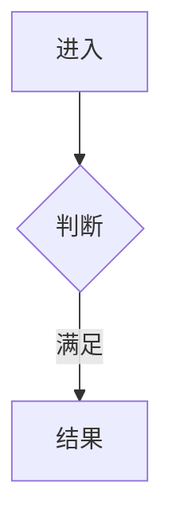

# Demo 轻量检查：可解析排版与边界

**依据是《ruan-project-reader Skill 设计规范（2.2）》及用户明确的两处最小补充（§5.1 原始任务逐条计数；§9 执行前复核已有成果、满足当前任务则消费）。** 本页仅说明本 Demo 脚本认识的 Markdown 序列化写法，不新增模块身份、状态库、固定 DFS 层数、唯一父模块、额外复查轮次或业务完成规则。规范允许而脚本尚不支持的写法，报告“未验证”，不据此断言设计错误。例子是格式，不是项目事实。

## 命令与结果

```bash
python3 scripts/check.py /实际路径/project-map
python3 scripts/check.py /实际路径/project-map --json
```

只读，无依赖（Python 3.10+ 标准库），不修改源码、Markdown 或状态。`--json` 只输出报告到标准输出，**不建立 JSON 状态数据库**。

- 退出码 `0`：本次适用且实际执行的机械检查均通过。
- 退出码 `1`：存在可确定的记录契约违反；即使同时有未验证，也不掩盖失败。
- 退出码 `2`：无确定失败，但有输入无法解析、检查未执行或能力不支持。
- 报告将发现、处置、完成等分开，不用后两项掩盖发现漏报。源码真实性、隐藏调用、业务语义和分类理由始终另列“人工核验（脚本未验证）”。机械通过不等于理解充分，不允许由脚本自动切状态。

**待办数依用户对 §5.1 的补充，按当前仍未完成的原始任务记录逐条计数；阻塞数是其中当前类型为“阻塞”的原始任务记录数。** Demo 将模块和 COVERAGE 的 `未决` 表用作当前原始任务记录；候选表对它们的引用与 STATE 的摘要不重复计入。A、B 分别登记而指向同一模块，计 2；分别复核完成并更新原始记录后，派生为 1、0。不按来源、模块或文字相似度去重，不增加任务 ID、历史库或状态枚举。

依用户对 §9 的补充，执行某条任务前由本地 AI 检查实际文档、未决与落库状态，核对源码证据确实满足**当前任务**才复核并消费该条；不满足则继续调查，必要时按 §8.2 重开模块。文件存在或“本层完成”本身不是当前任务已完成的证明。消费后更新相应原始记录与已有候选处置、从当前未决中移除已完成项，再派生 STATE；**check 仅检查当前快照，不执行任务、不核实这一语义条件，也绝不会自动消费记录。**

**2.2 仍未定义“覆盖记录数”的单位。** 该项核对独立保留为未验证，报告附 COVERAGE 原始表行数仅供诊断。正常样例可以所有确定项通过、总结果仍为未验证；不能把它包装成完整通过。

## Markdown 约定

采用 UTF-8，普通 `##` 标题和 pipe 表。固定表头及列顺序与规范相同；下文追加的短注、覆盖、未决表头只为 Demo 解析，**不是规范新固定表头**。单元格中的竖线写成 `\|`。表内不插空行，不把第二张表放在同一记录节。空集合保留表头和分隔行且没有数据行；未决也可写“无”。`待填写`、省略号等占位项不是事实，报告未验证。缺失、负数、无法解析的数量不会当零。

普通 Markdown 链接写作 `[名称](relative/file.md#锚点)`。脚本验证本地文件与已支持锚点；不联网验证外部 URL，存在外部 URL 时其存活性明确未验证。支持同文档锚点和相对文件路径；引用式链接、复杂链接语法未验证。正文标题可作锚点，或使用 `<a id="名称"></a>`。Mermaid 节点 ID 也可用作 Demo 节点定位符，但它必须在实际图中存在；若阅读平台不支持图节点跳转，可加同名显式 HTML 锚点。

### 模块

模块位于 `modules/**/*.md`，总览为 `modules/00-总览.md`。标题附近、第一小节前写规范固定两行：

```text
状态：梳理中
限制：无
```

合法状态仅 `梳理中 / 本层完成 / 已证叶子`，限制仅 `无 / 有`。不把“有 + 一段解释”写进限制值；解释另放 `## 限制说明` 或未决中。

`## 候选记录` 写四个实际字段：`扫描范围：…`、`扫描方法：…`、`检查对象数：非负整数`、`未检查区域：无或实际区域`，随后规范固定表：

```markdown
| 来源位置 | 候选 | 类别 | 数量 | 处置 | 证据或去向 |
| --- | --- | --- | --- | --- | --- |
```

九类别、六处置严格使用规范原值。检查对象数等于数量之和。前七种触发类别不得处置为琐碎。候选来源、类别和理由的真实性须人工核查。本文已解释定位图节点或正文；模块引用指向已有模块。兼容裸 `#正文标题` 与裸 `.md` 路径；所有相对路径均相对当前 Markdown 所在目录，不自行猜测根目录语义（例如模块引用同目录文档写 `子模块.md`）。通常优先 Markdown 链接。

`## 逐节点短注` 使用：

```markdown
| 节点 ID | 原标签 | 简短说明 | 去向 |
| --- | --- | --- | --- |
| A | 接收事件 | 核对当前事件 | 无 |
| B | 执行主体 | 下钻处理当前事件 | 下钻：[主体](主体.md) |
```

可见节点与短注一一对应、原标签一致。在“去向”字段或显式 `[下钻]`/`[引用]`/`下钻：`/`引用：` 中标识的节点写有效模块链接（业务文字“引用计数”不算引用标记），尚未建立可写 `待办：[相关未决](#未决)`。不是所有普通执行步骤都须建文件。

### Mermaid 解析子集

只做有限的节点/短注对应，不声称完整语法或视觉校验。支持 `flowchart TD/TB/BT/LR/RL` 或 `graph`；每行一个显式节点声明或一条引用已有 ID 的边：



节点 ID 支持字母/下划线起始的字母、数字、下划线、连字符。支持 `[]`、`()`、`{}`、`[[]]`、`(())`、`([])`、`[()]`、`{{}}`；边支持 `-->`、`---`、`==>`、`-.->` 以及 `|标签|`。支持注释行和行尾分号。节点、边分开写便于有限解析；边中只出现的 ID 仍算可见节点（其默认标签就是 ID）。

合法但本 Demo 不支持的写法（如一行串联/声明加边、subgraph、样式/class、click、新形状、其他图类型）明确未验证，不判为 Mermaid 无效，也不忽略后冒称所有节点通过。

### 未决和限制

`## 未决` 使用自然源码位置/候选定位文本，不新增编号体系：

```markdown
| 来源 | 类型 | 问题 | 下一步 | 已尝试方法 | 缺失依据 | 影响 | 重试条件 |
| --- | --- | --- | --- | --- | --- | --- | --- |
```

类型是 `待核实 / 阻塞 / 限制`。待核实须有问题与下一步；阻塞、限制须有问题、已尝试方法、缺失依据、影响与重试条件。非适用字段写“无”，不能用“无”填必需信息。

候选对应来源优先写 `来源位置 / 候选`，也接受仅源位置（记录语义对应关系仍需本地核实）；COVERAGE 入口/汇点使用既有 `E1 / S1`，扫描缺口使用实际方法方向名；模块扫描缺口可写 `未检查区域`。同一源码位置或模块可以对应多条独立原始任务；按每行计数，有匹配承接即核对其逐行字段，不要求来源唯一，也不自动合并。别处以合法自然语言记录的未决，若不能机械定位，报告未验证，交由本地核验。

独立 `## 限制说明` 可用 `问题：`、`已尝试方法：`、`缺失依据：`、`影响：`、`重试条件：` 五字段；脚本只核对齐备，不判断实质真实性。限制为“有”且没有对应阻塞/完整说明时失败。已证叶子不能有未处置候选或未决，限制必须无。

### 闸门记录

`## 闸门记录` 使用规范固定六列表，四行检查项原文为：`入口 → 结果`、`源码 → 流程`、`封装 → 隐藏环节`、`未决 → 处置`。对象数、问题数、其中阻塞本层均为非负整数，零也明写。`其中阻塞本层`不得超过`问题数`，不适用须在说明给原因。不要求“问题数≤对象数”（规范未定义这项关系）。梳理中允许暂缺闸门；完成或叶子缺闸门/缺项、其中阻塞本层非零明确失败。脚本不证实“本层可完成”的语义断言。

### COVERAGE 与 STATE

`COVERAGE.md` 的 Demo 表：

```markdown
## 入口
| 序号 | 来源位置 | 主体流程 | 总览节点 | 下一步 |
| --- | --- | --- | --- | --- |

## 汇点
| 序号 | 来源位置 | 定位或孤立候选 | 下一步 |
| --- | --- | --- | --- |

## 发现方法
| 方法或方向 | 适用性 | 扫描范围 | 扫描方法 | 检查对象数 | 未检查区域 | 新增候选数 | 说明 |
| --- | --- | --- | --- | --- | --- | --- | --- |

## 交叉复查
| 产生候选的方法或方向 | 交叉复查方法或方向 | 检查范围 | 方法 | 检查对象数 | 新增候选数 | 未检查区域 | 未决去向 |
| --- | --- | --- | --- | --- | --- | --- | --- |
```

Demo 支持简单 E 序号/入口与 S 序号/汇点；规范中的 E1/S1 只是示例，其他简单序号写法报告未验证，不判违反规范；不引入新身份体系。入口总览映射写 `[节点标签](modules/00-总览.md#节点ID)`，验证目标是实际 Mermaid 节点；该节点短注或以该节点 ID 为题的正文中列 E 序号（其他正文关联写法报告未验证）。主体流程写模块链接。总览允许多个入口归同一节点、多个调用者复用同一模块，不构建唯一父树。

汇点链接 `模块.md#候选记录` 时，来源位置须在该候选表的来源位置列明确出现；链接正文节时，其源码位置须在该正文明确出现。不把文件存在、节点可达当已映射。暂未映射写“孤立汇点候选”（兼容“孤立候选”），并填写下一步、在未决承接。入口未映射亦有下一步、未决。关于证据是否实际支持结论，始终人工核验。

若在 COVERAGE 中明确声明 `本轮范围整体完成：是`，脚本会要求该文件具备规范四项闸门；未使用该机器可读声明时不揣测自然语言中的整体完成声称。本节仅字段约定，不新增整体完成状态体系。

`STATE.md` 写当前焦点、下一步和八个摘要字段，每个用`字段：值`单独一行：梳理中模块数、本层完成模块数、已证叶子模块数、待办数、阻塞数、入口数、汇点数、覆盖记录数。原始记录是模块与 COVERAGE；STATE 不是第二份真相。待办与阻塞按前述原始任务口径派生；无法解析的字段和仍未定义的覆盖记录数口径明确未验证。
