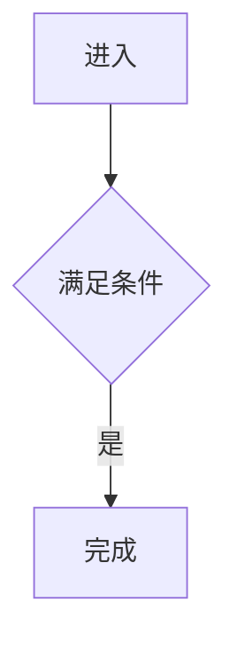

# 记录契约与轻量检查

`check.py` 只读知识库，Python 3.10+ 标准库，无安装依赖、不联网、不自动切状态或消费任务。`--json` 仅把报告写标准输出，不建立状态数据库。退出码 0 机械通过、1 存在失败、2 无失败但有未验证；失败优先，不遮盖未验证明细。

报告分记录、规范、发现、处置、节点、链接、完成、验收、汇总。只证明支持的记录契约相互一致。用户是否实际转交了远端质疑和完整稿、其记录位置及逐项处理结果，须按 [完成条件](completion.md) 人工核实。源码真实性、隐藏调用、发现漏报、分类理由、边界契约、颗粒度、叶子反证、图形语义与完整 Mermaid 语法同样另列人工核验，不能从机械通过推出业务理解充分或协作完成。

## 排版与缺失值

UTF-8 Markdown，普通标题和 pipe 表；单元格竖线写 `\|`，不在表内插空行。不支持的语法、无法解析的块、占位符和未知数字报未验证；可确定的缺字段、枚举或对应关系违规报失败。任何缺失值不按零处理。数字使用十进制非负整数；真实候选每行数量须正整数，空集合保留表头及分隔行，不填一行数量零。

表格使用下列模板的标题最可靠。候选与闸门也能按唯一固定表头定位，模块指纹仍要求模板必需节名；其他排版不强迫变更业务事实，不能解析时明确未验证。

## 模块与候选

模块在 `modules/**/*.md`，总览 `modules/00-总览.md`。第一节前两行：

```text
状态：梳理中
限制：无
```

状态只接受梳理中／待验收／本层完成／已证叶子，限制只接受无／有，详情另写。候选节必须有扫描范围、扫描方法、检查对象数、未检查区域四字段。

| 来源位置 | 候选 | 类别 | 数量 | 处置 | 证据或去向 |
| --- | --- | --- | --- | --- | --- |

九类别：事务锁并发、写库缓存状态、MQ异步后台、异常重试补偿、权限判断算法、配置分派、外部调用副作用、出向调用、其他。六处置：本文已解释、模块引用、外部边界、琐碎、待核实、阻塞。前七类不得琐碎；仅琐碎行可合并数量，其他单独追溯。检查对象数等于行数量总和，候选来源和分类的真实性人工核实。

本文已解释链接当前节点或正文；模块引用链接实际模块。推荐 Markdown 链接，兼容裸 `#正文锚点`、裸 `.md` 路径。相对路径以当前 Markdown 文件为基准，同目录模块写 `子模块.md`。外部边界／琐碎提供实质证据或理由，其充分性人工检查。

## 原始未决与计数

使用模块及 COVERAGE 的 `## 未决` 表存放原始未完成任务。候选、入口、汇点、扫描记录引用该任务，不再独立计一份；不同任务即使同来源或同模块，也逐行计数，不去重。完成后先更新原始记录和关联处置，从当前未决移除该项，再更新 STATE；不存强制历史。

| 来源 | 类型 | 问题 | 下一步 | 已尝试方法 | 缺失依据 | 影响 | 重试条件 |
| --- | --- | --- | --- | --- | --- | --- | --- |

类型为待核实／阻塞／限制。待核实有问题和下一步；阻塞、限制有问题、已尝试方法、缺失依据、影响、重试条件。必需信息不能填“无”，非适用字段可填无。确无未决时写“无”或保留空表，须由实际调查支持。

受限的待核实候选可以由同来源的“限制”记录承接，但仍须有下一步；保留其实际限制语义，不为匹配检查器改成阻塞。候选为“阻塞”则对应阻塞原始记录，阻塞计数不漏项。

候选任务来源写 `来源位置 / 候选`（也接受仅来源位置，语义对应人工核实）；入口／汇点用 E1／S1，扫描缺口用方法方向名，模块未查区用“未检查区域”，节点待办用图节点 ID。多个同源任务分别保留。无法找到承接或解析失败时，待办与阻塞派生值为未知，不默认为零。

限制“有”须有阻塞／限制记录；也可在 `## 限制说明` 写问题、已尝试方法、缺失依据、影响、重试条件五字段。独立完整限制说明计一条原始待办；若只是链接未决中的限制则不再计。待办数为这些原始任务行数加独立限制说明数，阻塞数仅为其中类型“阻塞”的任务行数。

## Mermaid 与短注

`## 逐节点短注` 表头：节点 ID／原标签／简短说明／去向。前两列与实际可见节点一一对应。去向通常写“无”，下钻／引用写模块链接，未建立写 `待办：[具体问题](#未决)`，并有以节点 ID 为来源的未决行。

检查器仅识别 flowchart／graph 的 TD、TB、BT、LR、RL；每行一个声明或一条边，声明与边分开：



支持 `[]`、`()`、`{}`、`[[]]`、`(())`、`([])`、`[()]`、`{{}}`；边为 `-->`、`---`、`==>`、`-.->`，可含 `|标签|`。支持注释、行尾分号。ID 以字母／下划线开头，后接字母数字下划线或连字符。未声明边端点也算可见节点，默认标签为 ID。

一行串联、声明加边、subgraph、样式、click、新形状或其他图类型报未验证，不能忽略后声称全图对应通过；这不表示 Mermaid 自身无效。按需要人工核验或用已有语法工具，不为适应检查器删除事实。

本地链接检查文件及支持的 Markdown 标题／HTML 锚点；图节点 ID 可作检查定位符，若要跨阅读器点击跳转，在短注旁补同名 `<a id="A"></a>`。引用式、复杂链接与外部 URL 存活性未验证；不发网络请求。

## COVERAGE 与汇总

字段：范围、召回探针、本轮发现暂时收敛（是／否）、本轮范围整体完成（是／否）。字段只是记录实际结论，不是额外审批状态。表头见 [COVERAGE 模板](../templates/COVERAGE.md)。

入口简单序号 E1…、汇点 S1…；非该写法未验证，不建立新身份体系。主体流程链接实际模块；总览节点链接 `modules/00-总览.md#A`，节点短注或以 A 为标题的正文须引用入口序号。汇点定位到候选记录或正文，其来源位置必须在该处明确出现，不能只在别处出现。未映射和孤立项有下一步及未决承接。

汇点定位采用原文匹配，不解析源码行区间的包含关系。请在汇点表和所指候选／正文复用同一定位字符串；例如 `NotifyService.java:11` 不能仅靠正文中的 `NotifyService.java:7-11` 被自动确认。可在正文补具体证据定位，人工仍须核实该位置的实际行为；格式匹配不能证明证据真实。

发现方法固定用“正向入口／反向汇点／盲区审查”三方向名，可增加方法；每行记录适用性、范围、方法、计数、未检查区域及说明。不适用须理由。交叉复查另表记录产生方法、复查方法、范围、实际方法、对象数、新增数、未检查区域和未决去向。

**覆盖记录数的本实现口径**：入口、汇点、发现方法、交叉复查四张登记表的行数之和（不含表头、闸门和未决）。这只为可复现统计，不表示覆盖率，不是对设计发现能力的新增判据。某表不能解析则该计数未知。STATE 模板沿用同一口径。

声明暂时收敛须三方向有记录，至少一条方法／方向不同且零新增的交叉复查。方法实质是否不同、真实零新增仍须人工核实。整体完成另要求全项目四项闸门、暂时收敛、无梳理中／待验收／受限模块、未决清空、入口和汇点落实、无未检查区；不能靠填写“是”绕过这些检查。

STATE 包含 `规范版本：2.4`、当前焦点、下一步和四状态模块数、待办数、阻塞数、入口数、汇点数、覆盖记录数，九项统计逐字段与原始记录对账；规范版本不是统计。STATE 中的链接和摘要不重复计数。

## 闸门与人工替代

[闸门表](../templates/gates.md) 四项固定：入口 → 结果、源码 → 流程、封装 → 隐藏环节、未决 → 处置。对象数／问题数／其中阻塞本层非负，阻塞不超过问题；不适用有原因。待验收／完成／叶子缺闸门或阻塞非零失败；拟完成类型为已证叶子的待验收同样检查叶子未处置与限制。问题数可非零，判断本层阻断以其中阻塞本层为准。脚本不判断闸门陈述真实与否。

没有 Python 或执行工具时，人工逐项核查：候选表头／枚举／数量与七类非琐碎；节点与短注及下钻承接；链接与入口／汇点实际定位；状态、限制、四项闸门；未决必需信息；九项汇总及本文件验收记录。逐项记录通过／失败／未验证及依据，并明确“脚本未执行”。无法核验的内容保留待办／限制，不能把人工结果冒称自动检查成功。

## 读者内容指纹

每模块使用模板的九个必需二级标题：职责与边界、执行图、逐节点短注、必要规则与源码依据、下钻、引用与外部去向、候选记录、未决、限制说明、核验与下一步；另设验收记录，待验收/完成须有闸门记录。

只读命令 `python3 <Skill目录>/scripts/check.py --fingerprint <模块文件>` 输出 JSON 文件定位、规范版本、算法 `reader-content-2.4-sha256`、小写64位 SHA-256 或明确失败/未验证。与正常 check、整体计算共用同一逻辑，不写回、不转状态。必须实际执行可信工具后引用结果，不得心算或编造。

1. 严格 UTF-8 解码，只移除起始一个 BOM；CRLF 换 LF。孤立 CR、编码/读取失败返回未验证，无有效哈希。不折叠空格，不对正文做 Unicode 规范化或渲染。
2. 按文档层的 CommonMark ATX/代码围栏规则扫描。标题缩进至多三个空格，`#` 后须空格/制表符或行尾；识别围栏外唯一一级标题和真实二级标题。匹配标题时修剪两端空白与可选尾部 `#`，哈希保留原始标题行。四空格缩进的行不当标题。围栏至少三个连续反引号或波浪线；反引号信息串不能含反引号。关闭行缩进至多三空格、同字符且数量不少于起始、尾部仅空格/制表符；内部 `##` 不切段。未闭合围栏或无法可靠解析则未验证。
3. 必需标题恰好各一份；缺失确定结构报失败，重复必需/排除标题报未验证，均无部分哈希。前置片段包含首个二级标题前所有文字（含一级标题上方非空内容）；删除唯一顶部状态行，将唯一限制行规范为 `限制：有` 或 `限制：无`，保留其他原文。状态/限制缺失、重复或非法仍失败。
4. 其余片段从真实二级标题至下一真实二级标题前。仅排除整个 `候选记录`、`闸门记录`、`核验与下一步`、`未决`、`限制说明`、`验收记录` 六节；所有其他章节，包括新增“补充”，按原次序纳入。不按关键词删行，不将读者需要的事实/未知移入排除节。
5. 每个保留片段只去末尾 LF，保留内部换行、空格及缩进；片段间连接两个 LF，末尾追加一个 LF，对 UTF-8 字节计算 SHA-256。状态切换与操作记录更新不改指纹；限制值、图、短注、事实或未知陈述改变会改指纹。

`## 验收记录` 五字段：`拟完成类型`（本层完成/已证叶子）、`读者内容指纹`、`核验基准`、`用户验收问题`、`用户验收回答`。梳理中尚未取得的字段可写未取得；待验收须有拟类型和实际技术基准，缺可信计算写未验证且不能转正。完成状态缺必需字段、非完整小写哈希、记录哈希与现稿不一致报失败；解析/计算未完成报未验证（无其他失败时退出2）。完成提问须列本文件名、指纹前8–12位，机器比较完整64位。是否实际用户无条件同意、语义核验是否充分由本地人工核实，脚本不推测回答意图。

无 Python 或可信等效计算工具时，调查和待验收可继续，指纹标未验证，用户认可也不能转正。工具恢复后实际重算、核对文件并再次确认具体版本。人工检查不能替代哈希计算。

## 整体清单与指纹

COVERAGE 的 `## 整体验收记录` 含 `整体读者内容指纹`、`技术核验`、`用户验收问题`、`用户验收回答` 四字段，以及单列 `模块路径` 表（相对 project-map 的路径原文，不嵌 Markdown 链接）。未发起时字段写未取得、表为空；声明整体待验收时列全范围，不能藏未完成模块。当前目录 `modules/**/*.md` 全量清点，包括总览，均属本轮交付集合；需要改变实际范围先与用户核实，不由检查器猜测自然语言排除项。

`python3 <Skill目录>/scripts/check.py --scope-fingerprint <project-map>` 只读输出清单、算法 `reader-scope-2.4-nfc-utf8-sha256` 与64位指纹。空的未发起清单按实际文件清点生成；已填写清单必须恰好与清点一致，不得重复、遗漏、含范围外文件或越界。每个模块使用同一单文件算法，任何一个未验证/失败均不输出整体成功哈希。

路径分隔符转 `/`，对相对路径做 Unicode NFC，检测规范化同名冲突；按 NFC 路径 UTF-8 字节序排序。逐项连接 `路径UTF-8 + NUL + 单文件小写64位SHA-256的ASCII + LF`，对整个字节序列再 SHA-256。正文不做 NFC。新增、删除、改名、范围或读者内容变化须重新核对。

有整体清单时核对全部模块个别完成、有效单文件记录/指纹及全项目技术门槛；整体声明为是时另须当前整体指纹和用户问题/回答。整体指纹只绑定文件集合；覆盖事实、配置或模块重开导致的即时撤销按 [完成规则](completion.md) 执行，静态哈希无法证明撤销历史，也不能使已撤销认可自行恢复。

## 规范识别与显式迁移

缺 `规范版本` 且仅三状态/八统计、未混入验收字段的知识库，按对应静态契约只读检查；合法时返回未验证(2)，提示“2.4 用户验收尚未验证”，明确旧结构错误仍失败(1)。出现待验收、新统计或验收字段却无版本，或声明2.4却缺所需结构，不降级规避：确定错误失败、无法解析未验证。安装 Skill 不改知识库，所有检查入口不执行迁移。

迁移流程由用户明确启动，范围为整个 project-map，模块验收可分批：

1. 先报告当前技术状态、缺少的用户凭据、整个知识库范围及完成模块清单；提醒用户自行提交 Git 或备份到知识库之外。无明确指令不写入，不自动提交/推送，也不在知识库保存历史正文副本。
2. 逐模块核对已有闸门/技术依据、源码基准与配置定位，询问用户基准后源码/生效配置是否变化。若有 Git 可比较基准，按引用路径、配置和依赖影响核对差异；差异仅证明实际覆盖路径，不能推出未记录动态配置或隐式依赖不变。
3. 保留原完成类型作为拟完成类型。既有技术依据可沿用、无已知矛盾时进入待验收，核验基准写“沿用既有技术核验记录，未重新读取源码”，明确所沿用记录位置。无法证明当前基准未变，写“基准未知”；验收问题明示“无法证明当前源码与既有核验时一致”，由用户明确决定是否接受历史技术成果的不确定性，不把其接受写成当前源码一致。用户要求按当前源码复核、已知相关变化或重大矛盾时，补证受影响范围；缺证项保持梳理中，不能用用户认可越过技术闸门。
4. 整库一次性补齐规范版本、四状态、验收记录及九统计；所有无新验收的完成模块都先待验收或梳理中，整体完成置否、整体记录未取得。保留候选、覆盖、原始未决和读者正文；只有结构必需的字段/标题调整才改，不能大幅重写。尚在梳理中的模块不自动获准。
5. 前后分别执行适用检查，报告基准已知/未知、沿用依据、受影响范围、用户决定、未决/未验证。完成格式调整后只按2.4检查。分批验收均列明确文件，各自记录指纹与凭据；未认可者继续待验收，不建第二套审批事实源。
