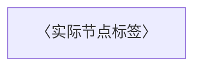

# 〈模块名称〉
状态：梳理中
限制：无

## 职责与边界

〈进入条件、输入、主要行为、成功／失败／异步出口；当前层责任及场景差异〉

## 执行图

## 逐节点短注

| 节点 ID | 原标签 | 简短说明 | 去向 |
| --- | --- | --- | --- |
| A | 〈实际节点标签〉 | 〈约20字短注〉 | 〈无／下钻或引用链接／待办链接〉 |

## 必要规则与源码依据

〈先向下预研再组织本层图文，列出支撑本层陈述的实际工作位置、条件、状态、异常、事务、配置、外部契约等证据。事实／推断／待核实分开，说明读者必须了解的重要未知及其影响；可变待办、调查进度与下一动作放未决，候选处置放候选记录。〉

## 下钻、引用与外部去向

〈模块链接、当前场景输入和适用分支、实际可达出口和后继；未知指向未决。外部边界给我方调用及输入、契约、成功／失败／超时处理依据。〉

## 候选记录

扫描范围：〈已实际检查的执行体和调用范围〉
扫描方法：〈可重跑命令或明确检索模式〉
检查对象数：〈数量之和；未知不写零〉
未检查区域：〈具体缺口；确无填无〉

| 来源位置 | 候选 | 类别 | 数量 | 处置 | 证据或去向 |
| --- | --- | --- | --- | --- | --- |

## 未决

| 来源 | 类型 | 问题 | 下一步 | 已尝试方法 | 缺失依据 | 影响 | 重试条件 |
| --- | --- | --- | --- | --- | --- | --- | --- |

## 限制说明

无

## 核验与下一步

〈用户已转交的远端质疑及完整当前稿的内容或记录位置、逐项补证处理及尚存未决；本地实际源码核验、机械检查结果及未验证范围、人工核验、Mermaid是否自动验证、确认与下一步。尚未收到相应输入时写清等待事项并保持梳理中。进入待验收前核实协作输入与源码依据并补入四项闸门表；拟叶子须附反证依据。通过后仅待验收，用户认可具体指纹版本才转正；继续下一项须独立明确授权。〉

## 验收记录

拟完成类型：未取得
读者内容指纹：未验证
核验基准：未取得
用户验收问题：未取得
用户验收回答：未取得

总览使用此模板时：节点表示主体流程，短注或以节点 ID 为标题的正文引用 COVERAGE 的入口序号；边和候选仅跨流程交接，写发送端与对端位置，不复制入口清单或下层内部候选。普通模块删除本模板说明。所有占位均须替换为事实，表格为空也需实际扫描依据。
