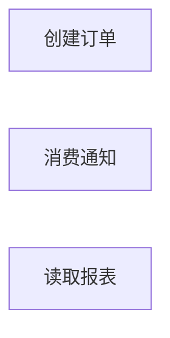

# 首次人工转交材料

本文件用于本轮验收模拟。请复制下面完整代码块交给模拟远端；本地已保存现场并暂停，尚无远端参与或认可记录。

````text
你是不能直接访问源码的远端 AI。本次是隔离合成样例的验收模拟，不是真实远端审查；本地只读所给 Python 源码，用户人工转交。本轮请求首次质疑，不假装已经收到反馈，不替本地声称运行过程序。

当前协作对象是项目总览；共同核验主体流程边界、关键条件与结果，以及可能的事件交接。当前 4 份知识库已保存，总览梳理中，限制有。尚未单独成文子模块，尚未收到远端质疑或完整稿。

模拟用户明确：ROUTES 是路由登记；worker.consume 是宿主调用的独立入口；没有运行服务器，宿主及动态装配未提供；允许展示这些合成源码。请只根据以下内容质疑，不自行猜测宿主。

已完成的实际检查：6 个源码文件逐行读取；正向入口、反向状态汇点、文件与导入盲区调查；AST 独立复查 7 个定义、4 条导入、9 处调用、5 处赋值，新增 0，仅适用于已提供文件。已执行用户提供入口召回探针，3 个入口均登记。整体发现仍不声明收敛。

check.py 退出码 2：314 项通过、6 项未验证、无失败。未验证包括扫描缺口承接 4 项与待办／阻塞派生 2 项；本地人工核对有 5 条原始未决，其中限制 2、待核实 3、阻塞 0。完整 Mermaid 语法未自动验证；人工核对节点与短注，未运行源码。机械检查不证明业务理解或协作完成。

请指出材料位置、疑点对图文的影响、所需证据，尤其核查漏入口／汇点、包装后的条件及异常出口、是否错误连接了独立流程、是否把同名 state 当成共享对象、颗粒度和复用是否适当。跨流程写入与读取已有条件证据时应核查媒介，但本轮缺少实际对象身份，不能猜补。普通源码问题由本地继续调查，不让用户代查；宿主缺失先保持限制。

本轮请返回首次质疑；证据充分的项目可明确确认，不为形式重复提问。用户转交反馈后，本地才逐项补证；完整当前稿在后续协作阶段提供。需要转交本地的内容放独立 Markdown 代码块，不直接联系其他 AI。

===== 已保存当前稿：README.md =====
# 项目执行流程导航

项目：隔离 Python 合成样例，源码基准为本轮实际读取的 `../source/` 六个 Python 文件。
范围：只读该样例；知识库保存在本目录。本轮为验收模拟，尚无真实远端审查。

从 [总览](modules/00-总览.md) 开始。
[覆盖与发现](COVERAGE.md) · [当前焦点和派生汇总](STATE.md)

当前仅形成总览待审稿。主体流程的内部关键规则已沿薄包装读到实际实现；宿主装配、状态来源和跨入口共享对象尚无证据。源码未运行，未修改。

===== 已保存当前稿：modules/00-总览.md =====
# 项目总览
状态：梳理中
限制：有

## 职责与边界

本轮协作对象是合成样例的项目总览。共同核验三个主体流程的边界、关键结果及可能的事件交接；本阶段交付可供首次远端质疑的草稿。

创建订单会核实启用开关和数量，拒绝时直接返回原因；允许时写订单并追加事件后返回 queued。消费流程从传入状态取出事件，缺单返回 missing，有单则追加通知并返回 notified。报表只读取请求 actor 与订单数。各流程未捕获的 Python 异常向调用方传播，宿主如何响应未知。

state 和 request 的实际类型、初值和共享方式未提供。下面关于 list、dict 典型异常和覆盖风险的说明以普通 Python 内建容器为条件，不将这一条件冒充已验证的宿主配置。

## 执行图



图中暂不连跨流程边：写入事件的对象与消费对象是否相同尚无宿主证据。此图不否认潜在异步交接；候选与未决保留了需补证的关系。每个节点包含其流程结果与未捕获异常出口，见下文。

## 逐节点短注

| 节点 ID | 原标签 | 简短说明 | 去向 |
| --- | --- | --- | --- |
| A | 创建订单 | E1：拒绝或写单入队，也可能抛错 | 待办：[订单流程深化](#未决) |
| B | 消费通知 | E3：先取事件，缺单或追加通知 | 待办：[消费流程深化](#未决) |
| C | 读取报表 | E2：返回请求人和订单数，亦可抛错 | 无 |

<a id="A"></a>
<a id="B"></a>
<a id="C"></a>

## 必要规则与源码依据

### 订单规则

已读到实际工作位置：routes.submit → service.create_order → rules.decide → policy.permitted；不能因前两层包装很薄而跳过 policy。

- `rules.py:4` 先求值 request 的 qty、state 的 enabled 与 limit，再调用判定。因此即使 enabled 为假，参数缺失仍可能先抛异常，并非总能返回 disabled。
- `policy.py:2-6` 按 Python 真值判断 enabled；假值返回 `(False, "disabled")`。否则 qty <= 0 或 qty > limit 返回 `(False, "quantity")`，其余返回 `(True, "ok")`。比较类型不兼容时异常不被捕获；未见整数限制。
- `service.py:5-6` 拒绝返回 status=rejected 与原因，无本函数内后续状态写入。允许时 `service.py:7` 以订单数量加一生成 ID；没有唯一性检查，对非连续普通字典键可能覆盖已有订单，不能称为保证递增的全局 ID。
- `service.py:8` 将 qty 写入订单；`service.py:9` 再向 events 追加 ID；随后返回 status=queued 与 ID。函数中未见事务、回滚、持久化或锁。若订单已写而追加失败，该函数无补偿；不能把 queued 理解为消费成功。

### 消费规则

`worker.py:2` 首先 pop(0)，然后检查 orders 是否有该 ID。普通列表为空时可抛 IndexError；字段缺失、容器行为不兼容等异常均未捕获。

`worker.py:3-4` 缺单返回 missing；事件已经移除。`worker.py:5` 有单时向 notices 追加 ID，之后返回 notified；这里仅证明写通知记录，不能称为已发送外部消息。若检查或追加失败，函数未重新入队、回滚或重试；宿主重试策略未知。

### 报表规则

`routes.py:9-10` 在调用内导入 build_report 并调用；`reporting.py:2` 返回 requested_by=request["actor"] 与 count=len(state["orders"])。没有本函数内授权判断或状态写入。actor 缺失、orders 缺失或不支持 len 等错误传播到调用者。宿主是否做鉴权未知，不能据此认定整个服务无鉴权。

### 跨流程关系

`service.py:9 → worker.py:2`：写方追加 order_id，读方从名为 events 的字段取首项，随后访问 orders。若宿主把同一个兼容 state 交给二者，存在按事件 ID 交接的异步责任边界；当前缺少对象身份、调度顺序及生命周期证据。这是条件推断，不是已经证实的部署关系。报表也读 orders，但同名字段不足以证明和下单流程共享实际对象，不画依赖边。

## 下钻、引用与外部去向

本轮已下研所有 6 个源文件的关键行为，尚未单独成文子模块。订单判定与两次写入、消费的先移除后检查及失败结果值得在总览协作闭环后深化，分别由 A、B 未决承接。报表当前在总览内联，未发现必须单独解释的多阶段语义。没有已证明的公共流程，不按同参数名建立公共模块。

宿主提供 request/state 并接收返回或未捕获异常；其运行契约缺失，见 [覆盖限制](../COVERAGE.md#未决)。本样例没有真实服务器运行证据，也没有外部 MQ、数据库或通知服务证据。

## 候选记录

扫描范围：全部三个主体流程的出向边界与跨流程状态媒介。
扫描方法：从 service.py 的状态写入反查 worker.py 的读取，再核对全部导入和调用；总览候选只列跨流程交接。
检查对象数：1
未检查区域：宿主对象身份、调度与装配；见本模块及 COVERAGE 未决。

| 来源位置 | 候选 | 类别 | 数量 | 处置 | 证据或去向 |
| --- | --- | --- | --- | --- | --- |
| service.py:9 → worker.py:2 | 队列交接 | MQ异步后台 | 1 | 待核实 | [跨流程关系](#跨流程关系) 与 [原始未决](#未决)；发送端 service.py:9，对端 worker.py:2 |

## 未决

| 来源 | 类型 | 问题 | 下一步 | 已尝试方法 | 缺失依据 | 影响 | 重试条件 |
| --- | --- | --- | --- | --- | --- | --- | --- |
| service.py:9 → worker.py:2 / 队列交接 | 限制 | 同名 events 是否为同一实际对象、何时调用消费尚不明确 | 获得宿主后核对 state 身份、事件交接时序与失败责任 | 读取两个执行体并扫描全部调用和导入 | 宿主传参、状态生命周期与调度契约 | 暂不能确认跨流程边或消费保障 | 提供相关宿主源码或可核实契约 |
| A | 待核实 | 订单判定、编号及先写单后入队尚未独立成文 | 总览协作闭环后复核本稿及源码，再决定并完成订单流程模块 | 无 | 无 | 无 | 无 |
| B | 待核实 | 消费的先移除事件、缺单与失败责任尚未独立成文 | 总览协作闭环后复核本稿及源码，再决定并完成消费流程模块 | 无 | 无 | 无 | 无 |
| 协作 | 待核实 | 尚未收到远端对总览的首次质疑，也未收到远端完整当前稿 | 等待模拟用户转交首次质疑；逐项补证后再次交接，最终收到完整稿再核验 | 无 | 无 | 无 | 无 |

## 限制说明

见 [未决](#未决) 中队列交接的限制，以及 [覆盖未决](../COVERAGE.md#未决) 中宿主装配限制；不重复计任务。

## 闸门记录

以下是梳理中草稿的本地预检，不构成本层完成。

| 检查项 | 检查范围 | 对象数 | 问题数 | 其中阻塞本层 | 说明 |
| --- | --- | --- | --- | --- | --- |
| 入口 → 结果 | E1、E2、E3 的源码内结果与异常边界 | 3 | 0 | 0 | 已定位三个主体节点并在正文解释结果；宿主行为保持限制 |
| 源码 → 流程 | S1 至 S4 的状态变更定位 | 4 | 0 | 0 | 四处汇点均映射到正文证据，未藏在包装名称下 |
| 封装 → 隐藏环节 | 三个主体流程 | 3 | 1 | 1 | policy 条件和状态顺序已读；跨流程对象身份仍缺依据 |
| 未决 → 处置 | 本模块 4 条与 COVERAGE 1 条原始未决 | 5 | 0 | 0 | 五条均保留下一步；限制附尝试、缺证、影响和重试条件，尚未解决 |

## 核验与下一步

首次本地静态取证已完成；尚无任何已收到的远端质疑、补证反馈或完整稿，本轮为验收模拟。三主体边界与四处状态变更已逐行人工对照；AST 复查零新增仅针对已提供的六个文件。未运行样例、服务器或业务测试。

已实际执行 Skill 自带 check.py --json，退出码 2：无失败、6 项未验证。4 项是未查区域与原始未决的自动关联未确认，另 2 项是由此导致的待办／阻塞派生未知。人工核对：模块候选未查区对应本模块队列交接限制；正向、反向与 AST 扫描未查区共同指向 COVERAGE 的宿主装配限制。原始任务为模块 4 条加覆盖 1 条，共 5 条，其中限制 2、待核实 3、阻塞 0；此计数为人工核验，不称自动派生成功。Mermaid 使用三个声明节点且无未经证实的边，已人工核对节点、标签、短注与语义；尚未使用完整 Mermaid 解析器自动验证。

本轮发现尚未收敛；跨流程候选 1 条尚未处置，原始未决共 5 条。本层和范围整体均未完成。当前稿保存后交付首次质疑提示词，然后暂停；收到模拟用户转交的质疑才逐项回源码补证。

===== 已保存当前稿：COVERAGE.md =====
# 发现与覆盖

范围：本轮授权的 `../source/` 六个 Python 文件；无运行服务器，宿主与动态装配未提供。所有源码静态读取，未运行业务函数。
召回探针：已执行；模拟用户明确给出 ROUTES 路由登记与 worker.consume 独立入口，分别对应 E1、E2、E3，未漏报。
本轮发现暂时收敛：否
本轮范围整体完成：否

## 入口

| 序号 | 来源位置 | 主体流程 | 总览节点 | 下一步 |
| --- | --- | --- | --- | --- |
| E1 | routes.py:3、routes.py:5，POST /orders 登记到 submit | [创建订单](modules/00-总览.md#A) | [A](modules/00-总览.md#A) | 无 |
| E2 | routes.py:3、routes.py:8，POST /reports 登记到 report | [读取报表](modules/00-总览.md#C) | [C](modules/00-总览.md#C) | 无 |
| E3 | worker.py:1，consume(state)，模拟用户指定由宿主调用 | [消费通知](modules/00-总览.md#B) | [B](modules/00-总览.md#B) | 无 |

入口已映射不表示运行装配已证。此处登记来源和触发事实，总览通过序号引用。

## 汇点

| 序号 | 来源位置 | 定位或孤立候选 | 下一步 |
| --- | --- | --- | --- |
| S1 | service.py:8 | [订单状态写入](modules/00-总览.md#订单规则) | 无 |
| S2 | service.py:9 | [事件追加](modules/00-总览.md#订单规则) | 无 |
| S3 | worker.py:2 | [先移除事件](modules/00-总览.md#消费规则) | 无 |
| S4 | worker.py:5 | [通知记录追加](modules/00-总览.md#消费规则) | 无 |

## 发现方法

| 方法或方向 | 适用性 | 扫描范围 | 扫描方法 | 检查对象数 | 未检查区域 | 新增候选数 | 说明 |
| --- | --- | --- | --- | --- | --- | --- | --- |
| 正向入口 | 适用 | source 全部 6 文件 | rg -n 'ROUTES\|def \|route\|subscribe\|schedule\|__main__' source；逐文件读调用体 | 6 | 宿主与动态装配，见本文件未决 | 3 | 7 个函数定义中确认 3 个外部入口；其余是已读内部调用 |
| 反向汇点 | 适用 | source 全部 6 文件 | rg -n 'state\[\|append\|pop\|commit\|insert\|update\|publish\|send\|fetch' source；逆查调用归属 | 6 | 宿主实际对象、并发与持久化实现，见本文件未决 | 4 | 确认 4 处状态变更；发现 1 个需要核实的跨流程事件交接 |
| 盲区审查 | 适用 | source 所有文件及 4 条 import | rg --files -g '*' source；AST 检查定义、导入、调用、赋值 | 6 | 宿主、动态装配、依赖及配置来源未提供，见本文件未决 | 0 | 文件全集仅为 6 个 .py；未提供配置清单不等于运行时无配置 |

## 交叉复查

| 产生候选的方法或方向 | 交叉复查方法或方向 | 检查范围 | 方法 | 检查对象数 | 新增候选数 | 未检查区域 | 未决去向 |
| --- | --- | --- | --- | --- | --- | --- | --- |
| 正向入口与反向汇点关键字扫描 | AST 结构复查与手工调用对照 | 全部 6 文件 | ast.parse 后列 7 个定义、4 条导入、9 处调用和 5 处赋值，与已读入口及汇点逐项对照 | 6 | 0 | 宿主动态行为 | [装配限制](#未决) |

零新增只适用于提供的静态文件，宿主相关缺口仍未解决，因此不声明发现收敛。

## 未决

| 来源 | 类型 | 问题 | 下一步 | 已尝试方法 | 缺失依据 | 影响 | 重试条件 |
| --- | --- | --- | --- | --- | --- | --- | --- |
| 盲区审查 | 限制 | 未知宿主如何解释路由字符串、调用消费入口、初始化状态与调度并发 | 获得宿主后回查装配、运行配置、容器类型和异常接收方；当前保留边界 | 全文件枚举、逐行读取、AST 导入与调用扫描 | 宿主实现、动态装配和生效配置 | 不能据当前样例断言部署可用、入口全量或生产执行保障 | 模拟用户提供宿主或限定的可信契约 |

===== 已保存当前稿：STATE.md =====
# 当前工作现场

当前焦点：modules/00-总览.md 的首次本地待审稿已保存；等待模拟用户人工转交远端首次质疑，尚未收到远端完整当前稿。
下一步：保持等待并结束本次执行；收到首次质疑后，先读总览、COVERAGE 和本现场，逐项复核当前源码及保存状态，补证回写后再次转交并暂停。总览协作闭环后再处理 A、B 的深化待办。
梳理中模块数：1
本层完成模块数：0
已证叶子模块数：0
待办数：5
阻塞数：0
入口数：3
汇点数：4
覆盖记录数：11

[原始模块未决](modules/00-总览.md#未决) 4 条，[原始覆盖未决](COVERAGE.md#未决) 1 条；其中 2 条类型为限制，0 条类型为阻塞。阻塞数为 0 不代表没有限制或可以切完成。

核验口径：待办数与阻塞数由本地逐行人工核对；check.py 对扫描缺口承接未完全识别，自动派生为未知，不能称自动汇总通过。其余六个状态／覆盖计数自动一致。

===== 实际合成源码内容；路径仅作定位，内容已全文附出 =====

routes.py
1: from service import create_order
2: 
3: ROUTES = {"POST /orders": "submit", "POST /reports": "report"}
4: 
5: def submit(request, state):
6:     return create_order(request, state)
7: 
8: def report(request, state):
9:     from reporting import build_report
10:     return build_report(request, state)

worker.py
1: def consume(state):
2:     order_id = state["events"].pop(0)
3:     if order_id not in state["orders"]:
4:         return "missing"
5:     state["notices"].append(order_id)
6:     return "notified"

service.py
1: from rules import decide
2: 
3: def create_order(request, state):
4:     allowed, reason = decide(request, state)
5:     if not allowed:
6:         return {"status": "rejected", "reason": reason}
7:     order_id = len(state["orders"]) + 1
8:     state["orders"][order_id] = request["qty"]
9:     state["events"].append(order_id)
10:     return {"status": "queued", "id": order_id}

reporting.py
1: def build_report(request, state):
2:     return {"requested_by": request["actor"], "count": len(state["orders"])}

rules.py
1: from policy import permitted
2: 
3: def decide(request, state):
4:     return permitted(request["qty"], state["enabled"], state["limit"])

policy.py
1: def permitted(qty, enabled, limit):
2:     if not enabled:
3:         return False, "disabled"
4:     if qty <= 0 or qty > limit:
5:         return False, "quantity"
6:     return True, "ok"

````
