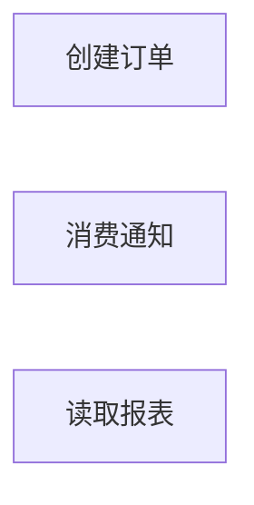

# 请求完整当前总览：模拟转交

当前补证稿已保存。本文件代码块包含完整转交材料；本地交付后暂停，等待完整稿。

````text
你是不能直接访问源码的模拟远端 AI。本次仍是隔离合成样例验收，不是真实远端审查；用户人工转交，不能冒称核实未提供材料或运行过程序。

当前协作对象：项目总览。两条模拟质疑已经本地回源码补证，现在请提交完整当前总览 Markdown；本轮没有既有远端完整稿。本地会核验你的完整稿，不能由你直接切换正式状态。

已确认补证：rules.py:4 按从左到右求值 qty、enabled、limit；普通字典缺 qty 先抛 KeyError，不进入 permitted；三项均取值成功且 enabled 假值才在 policy.py:2-3 返回 disabled，并由 service.py:4-6 返回 rejected。service.py:8-10 写单并追加事件后返回 queued，没有等待 consume；worker.py:2-6 先取事件，缺单返回 missing，有单追加 notices 后返回 notified。queued 不是消费或通知成功；notified 也不证明已向外部发送。宿主共享 state、调度及重试仍未知。

新增入口已立即登记 E4：授权摘录 extra_routes.py:10-12 的 audit 包装将 request 传给 AuditService.execute。内部没有提供，在本地 source 检索无相关命中；这不证明实现不存在。E4 仍未展开、未映射，主体结果和潜在汇点未知，不臆造节点或跨流程边。

已保存四份当前知识库；原始未决 6，其中限制 3、待核实 3、阻塞 0。入口 4，汇点 4，覆盖登记 12，唯一模块梳理中。保持发现未收敛、本层未完成、范围未完成。新 E4 使旧预检失效，当前预检记录入口与隐藏环节仍有阻碍完成的问题。

本轮实际 check.py 最终退出码 2：341 项通过、6 项未验证、无失败；自动未决关联与待办／阻塞派生不能确认，人工按原始任务核对。未运行源码或服务器；Mermaid 完整语法未自动验证。不得将机械结果当协作完成。

下面附实际输入、完整当前知识库和必要源码内容。请给完整当前总览，保留状态／限制、职责边界、唯一 Mermaid、节点短注、源码规则、候选、未决和实际预检；保留 E4 及宿主限制，不凭服务名猜补。当前图仅覆盖 E1 至 E3；你可以质疑这一表达，但应指出具体依据及所需补证，不能伪造已读 AuditService。

请在完整稿后列已确认、尚存问题与下一步；给用户转交本地的内容放在独立 Markdown 代码块。仍由用户手动转交，不联系其他 AI。本地收到完整稿后才恢复核验。

===== 实际收到的模拟输入 =====
# 模拟用户转交输入 Q1

本文件由维护者构造，用于隔离验收；没有真实远端审查。

## 模拟远端质疑

1. 总览“订单规则”说 rules.decide 在 enabled 为假时仍可能先抛错。请回到源码补证：qty 缺失与 qty 齐备两种情况下，参数求值和 disabled 返回的先后顺序是什么？提供具体源码位置；无需增加业务实现。
2. 总览中的 queued 能否被读成已经通知？请核验 service 与 worker 的出口和实际交接条件。现有宿主缺失应保留，不把推测写成事实。

请逐项回写补证，然后交接请求远端提交完整当前总览。

## 模拟用户提供的额外源码摘录

已确认另有下列入口。以下只是获授权的源码摘录，并非当前六个文件内的实现；AuditService 内部材料未提供。当前协作对象仍为总览。

摘录定位：extra_routes.py:10-12。

```python
@route("/audit", methods=["POST"])
def audit(request):
    return AuditService.execute(request)
```

===== 当前保存稿：README.md =====
# 项目执行流程导航

项目：隔离 Python 合成样例，源码基准为 `../source/` 六个 Python 文件及 [Q1 输入](../simulated-questions.md) 中新增授权摘录。
范围：只读该样例；知识库保存在本目录。本轮为验收模拟，尚无真实远端审查。

从 [总览](modules/00-总览.md) 开始。
[覆盖与发现](COVERAGE.md) · [当前焦点和派生汇总](STATE.md)

当前已收到两条模拟质疑并完成本地补证，等待远端完整当前总览。新增 E4 未展开、未映射。主体流程的内部关键规则已沿薄包装读到实际实现；宿主装配、状态来源和跨入口共享对象尚无证据。源码未运行，未修改。

===== 当前保存稿：modules/00-总览.md =====
# 项目总览
状态：梳理中
限制：有

## 职责与边界

本轮协作对象是合成样例的项目总览。本轮已收到模拟用户转交的两条首次质疑，现对三个已映射主体流程补证，并登记额外入口 E4 的未知边界；本阶段交付补证后的总览草稿，请求远端完整当前稿。

创建订单会核实启用开关和数量，拒绝时直接返回原因；允许时写订单并追加事件后返回 queued。消费流程从传入状态取出事件，缺单返回 missing，有单则追加通知并返回 notified。报表只读取请求 actor 与订单数。这三个已读流程未捕获的 Python 异常向调用方传播，宿主如何响应未知。新增授权摘录确认另有 E4，但其实际执行体缺失，已在 COVERAGE 保留未展开／未映射，尚未纳入已核实的三个主体节点。

state 和 request 的实际类型、初值和共享方式未提供。下面关于 list、dict 典型异常和覆盖风险的说明以普通 Python 内建容器为条件，不将这一条件冒充已验证的宿主配置。

## 执行图



当前图只表达已映射的 E1、E2、E3，E4 的缺口见 COVERAGE 原始未决，不据包装调用臆造完整审计流程。图中暂不连跨流程边：写入事件的对象与消费对象是否相同尚无宿主证据。此图不否认潜在异步交接；候选与未决保留了需补证的关系。每个节点包含其流程结果与未捕获异常出口，见下文。

## 逐节点短注

| 节点 ID | 原标签 | 简短说明 | 去向 |
| --- | --- | --- | --- |
| A | 创建订单 | E1：拒绝或写单入队，也可能抛错 | 待办：[订单流程深化](#未决) |
| B | 消费通知 | E3：先取事件，缺单或追加通知 | 待办：[消费流程深化](#未决) |
| C | 读取报表 | E2：返回请求人和订单数，亦可抛错 | 无 |

<a id="A"></a>
<a id="B"></a>
<a id="C"></a>

## 必要规则与源码依据

### 订单规则

已读到实际工作位置：routes.submit → service.create_order → rules.decide → policy.permitted；不能因前两层包装很薄而跳过 policy。

- `rules.py:4` 的实参按从左到右求值：request["qty"]、state["enabled"]、state["limit"]；全部取值成功才进入 permitted。对普通字典，qty 缺失会在第一项求值抛 KeyError，未读取后续两项，也未进入 policy.py:2，因此不会返回 disabled。qty 齐备仍不够：enabled 或 limit 缺失也会在进入 permitted 前抛错。三项均成功取值、且 enabled 为假值时，才在 policy.py:2-3 返回 `(False, "disabled")`，不执行数量比较；service.py:4-6 再把该结果转换为 status=rejected、reason=disabled。
- `policy.py:2-6` 按 Python 真值判断 enabled；假值返回 `(False, "disabled")`。否则 qty <= 0 或 qty > limit 返回 `(False, "quantity")`，其余返回 `(True, "ok")`。比较类型不兼容时异常不被捕获；未见整数限制。
- `service.py:5-6` 拒绝返回 status=rejected 与原因，无本函数内后续状态写入。允许时 `service.py:7` 以订单数量加一生成 ID；没有唯一性检查，对非连续普通字典键可能覆盖已有订单，不能称为保证递增的全局 ID。
- `service.py:8` 将 qty 写入订单；`service.py:9` 再向 events 追加 ID；随后在 `service.py:10` 返回 status=queued 与 ID。queued 只证明该函数内写入和 append 已正常返回，函数没有调用 worker.consume 或等待通知结果。函数中未见事务、回滚、持久化或锁。若订单已写而追加失败，该函数无补偿；不能把 queued 理解为消费成功。

### 消费规则

`worker.py:2` 首先 pop(0)，然后检查 orders 是否有该 ID。普通列表为空时可抛 IndexError；字段缺失、容器行为不兼容等异常均未捕获。

`worker.py:3-4` 缺单返回 missing；事件已经移除。`worker.py:5` 有单时向 notices 追加 ID，之后在 `worker.py:6` 返回 notified；这里仅证明写通知记录，不能称为已发送外部消息。若检查或追加失败，函数未重新入队、回滚或重试；宿主重试策略未知。

### 报表规则

`routes.py:9-10` 在调用内导入 build_report 并调用；`reporting.py:2` 返回 requested_by=request["actor"] 与 count=len(state["orders"])。没有本函数内授权判断或状态写入。actor 缺失、orders 缺失或不支持 len 等错误传播到调用者。宿主是否做鉴权未知，不能据此认定整个服务无鉴权。

### 跨流程关系

`service.py:9 → worker.py:2`：写方追加 order_id，读方从名为 events 的字段取首项，随后访问 orders。若宿主把同一个兼容 state 交给二者，存在按事件 ID 交接的异步责任边界；当前缺少对象身份、调度顺序及生命周期证据。这是条件推断，不是已经证实的部署关系。报表也读 orders，但同名字段不足以证明和下单流程共享实际对象，不画依赖边。

### 新增入口摘录的边界

本轮新增授权输入见 [模拟用户输入 Q1](../../simulated-questions.md)。摘录定位 extra_routes.py:10-12，显示 audit 将 request 传给 AuditService.execute 并直接返回其结果；除这个包装调用外，未提供真实工作位置、结果与副作用。已在全部已授权 source 内检索 AuditService、def audit、/audit，无相关命中；这一结果只证明当前提供范围未找到，不能证明项目没有实现。

入口事实统一登记在 [COVERAGE 的 E4](../COVERAGE.md#入口)，仍未展开、未映射；缺口及下一动作由 [E4 原始未决](../COVERAGE.md#未决) 承接。未知调用的名称不足以建立审计节点、汇点或跨流程边，也不足以认定它是外部系统边界。

## 下钻、引用与外部去向

原六文件的关键行为已下研，本轮又复核 rules、policy、service、worker；新增 AuditService 的内部行为尚不可见，未单独成文任何子模块。订单判定与两次写入、消费的先移除后检查及失败结果值得在总览协作闭环后深化，分别由 A、B 未决承接。报表当前在总览内联，未发现必须单独解释的多阶段语义。没有已证明的公共流程，不按同参数名建立公共模块。

宿主提供 request/state 并接收返回或未捕获异常；其运行契约缺失，见 [覆盖限制](../COVERAGE.md#未决)。本样例没有真实服务器运行证据，也没有外部 MQ、数据库或通知服务证据。

## 候选记录

扫描范围：三个已映射主体流程的出向边界与跨流程状态媒介；新增 audit 摘录只检查可见包装，内部不可见。
扫描方法：从 service.py 的状态写入反查 worker.py 的读取，再核对全部导入和调用；总览候选只列跨流程交接。
检查对象数：1
未检查区域：宿主对象身份、调度与装配，以及新增 AuditService 实现；见本模块交接限制和 COVERAGE 的 E4 未决。

| 来源位置 | 候选 | 类别 | 数量 | 处置 | 证据或去向 |
| --- | --- | --- | --- | --- | --- |
| service.py:9 → worker.py:2 | 队列交接 | MQ异步后台 | 1 | 待核实 | [跨流程关系](#跨流程关系) 与 [原始未决](#未决)；发送端 service.py:9，对端 worker.py:2 |

## 未决

| 来源 | 类型 | 问题 | 下一步 | 已尝试方法 | 缺失依据 | 影响 | 重试条件 |
| --- | --- | --- | --- | --- | --- | --- | --- |
| service.py:9 → worker.py:2 / 队列交接 | 限制 | 同名 events 是否为同一实际对象、何时调用消费尚不明确 | 获得宿主后核对 state 身份、事件交接时序与失败责任 | 读取两个执行体并扫描全部调用和导入 | 宿主传参、状态生命周期与调度契约 | 暂不能确认跨流程边或消费保障 | 提供相关宿主源码或可核实契约 |
| A | 待核实 | 订单判定、编号及先写单后入队尚未独立成文 | 总览协作闭环后复核本稿及源码，再决定并完成订单流程模块 | 无 | 无 | 无 | 无 |
| B | 待核实 | 消费的先移除事件、缺单与失败责任尚未独立成文 | 总览协作闭环后复核本稿及源码，再决定并完成消费流程模块 | 无 | 无 | 无 | 无 |
| 协作 | 待核实 | 已收到并补证两条模拟远端质疑，尚未收到远端完整当前总览 | 等待模拟用户转交完整稿；收到后逐项对照补证事实、E4 限制与当前源码，核验后决定是否可过闸 | 无 | 无 | 无 | 无 |

## 限制说明

见 [未决](#未决) 中队列交接的限制，以及 [覆盖未决](../COVERAGE.md#未决) 中宿主装配限制；不重复计任务。

## 闸门记录

新增 E4 后旧预检不再有效；下表为本轮重新核对后的梳理中草稿预检，不构成本层完成。

| 检查项 | 检查范围 | 对象数 | 问题数 | 其中阻塞本层 | 说明 |
| --- | --- | --- | --- | --- | --- |
| 入口 → 结果 | E1 至 E4 | 4 | 1 | 1 | E1 至 E3 的结果已补证；E4 只有包装，主体流程及结果未知 |
| 源码 → 流程 | S1 至 S4 的状态变更定位 | 4 | 0 | 0 | 四处汇点均映射到正文证据，未藏在包装名称下 |
| 封装 → 隐藏环节 | 三个已读主体流程及 audit 包装 | 4 | 2 | 2 | policy 条件和 queued／notified 边界已补证；共享对象与 AuditService 实现仍缺依据 |
| 未决 → 处置 | 本模块 4 条与 COVERAGE 2 条原始未决 | 6 | 0 | 0 | 六条均保留下一步；三条限制附尝试、缺证、影响和重试条件，尚未解决 |

## 核验与下一步

已收到的协作输入：[模拟用户输入 Q1](../../simulated-questions.md)，明确标注为维护者构造的验收模拟，不是真实远端审查。包含两条首次质疑和 extra_routes.py:10-12 的获授权摘录；没有远端完整稿。以下记录实际输入与逐项补证结果。

| 输入 | 本地复核与处理结果 | 尚存未决 |
| --- | --- | --- |
| Q1-1：qty 缺失与齐备时，参数求值及 disabled 返回的先后顺序 | 重读 rules.py:4、policy.py:2-3、service.py:4-6；在“订单规则”明确 qty、enabled、limit 的求值顺序。普通字典缺 qty 先抛 KeyError，三项齐备且 enabled 假值才返回 disabled；未新增业务实现，也未运行函数 | 实际容器类型仍受宿主限制，但两条条件化源码路径已补证 |
| Q1-2：queued 能否被读成已经通知，service 与 worker 的出口和交接条件是什么 | 重读 service.py:8-10、worker.py:2-6 并检索相关调用；queued 在订单写入与 events.append 正常返回后产生，没有等待 consume；notified 在消费端 notices.append 后产生。缺单返回 missing；异常均未捕获，图中不添加未证实的跨流程边 | state 对象共享、调度与重试仍待宿主证据；notified 也不能证明外部通知已发送 |
| 新摘录：另外确认 audit 入口，AuditService 内部未提供 | 立即登记 E4，随后检索现有 source 无相关实现命中。保持未展开／未映射，新增 E4 原始限制；未虚构服务行为、汇点、完成状态或模块 | 需要 AuditService 实现或可核实契约后核实主体流程及结果 |

本地人工核对了新增与受影响陈述、节点短注、源码位置和原始未决。保留三个已证主体节点，E4 仍无主体节点，未运行样例、服务器或业务测试。Mermaid 完整语法未自动验证。

本轮已实际执行 check.py --json，退出码 2：341 项通过、6 项未验证、无失败。4 项是模块及扫描未查区到原始未决的自动关联未确认，另 2 项是因此无法自动派生待办／阻塞数。人工复核承接关系：本模块交接限制覆盖 state 身份；COVERAGE 宿主限制覆盖装配及调度；E4 限制覆盖 AuditService 缺失。计数为原始表逐行人工核对，不冒称自动派生通过；保持梳理中。原始未决为模块 4 条加覆盖 2 条，共 6 条，其中限制 3、待核实 3、阻塞 0。候选仍为 1 条待核实的事件交接；入口变为 4，已定位汇点仍为 4，AuditService 的未知汇点不能当作零。发现未收敛，本层及范围整体均未完成。

本轮保存补证稿后，请模拟远端提交完整当前总览；交接后暂停，等模拟用户带回完整稿才进入核验阶段。完整稿仍须保留 E4 未映射与宿主限制，收到完整稿本身不构成过闸证据。

===== 当前保存稿：COVERAGE.md =====
# 发现与覆盖

范围：授权的 `../source/` 六个 Python 文件，以及 [模拟用户输入 Q1](../simulated-questions.md) 中 extra_routes.py:10-12 的获授权摘录；摘录不是当前 source 内的完整文件。无运行服务器，宿主与动态装配未提供。所有源码静态读取，未运行业务函数。
召回探针：已执行；原输入的 ROUTES 路由登记与 worker.consume 对应 E1、E2、E3。本轮新增用户已知入口 POST /audit，立即登记 E4；它来自追加的授权摘录，原六文件范围扫描没有包含该摘录，不能据此宣称整体发现充分。
本轮发现暂时收敛：否
本轮范围整体完成：否

## 入口

| 序号 | 来源位置 | 主体流程 | 总览节点 | 下一步 |
| --- | --- | --- | --- | --- |
| E1 | routes.py:3、routes.py:5，POST /orders 登记到 submit | [创建订单](modules/00-总览.md#A) | [A](modules/00-总览.md#A) | 无 |
| E2 | routes.py:3、routes.py:8，POST /reports 登记到 report | [读取报表](modules/00-总览.md#C) | [C](modules/00-总览.md#C) | 无 |
| E3 | worker.py:1，consume(state)，模拟用户指定由宿主调用 | [消费通知](modules/00-总览.md#B) | [B](modules/00-总览.md#B) | 无 |
| E4 | extra_routes.py:10-12，模拟用户授权摘录中的 POST /audit | 未展开 | 未映射 | 取得 AuditService 源码或可信契约后核验行为、结果与汇点，再映射主体流程；见本文件 E4 未决 |

入口已映射不表示运行装配已证。此处登记来源和触发事实，总览通过序号引用。

## 汇点

| 序号 | 来源位置 | 定位或孤立候选 | 下一步 |
| --- | --- | --- | --- |
| S1 | service.py:8 | [订单状态写入](modules/00-总览.md#订单规则) | 无 |
| S2 | service.py:9 | [事件追加](modules/00-总览.md#订单规则) | 无 |
| S3 | worker.py:2 | [先移除事件](modules/00-总览.md#消费规则) | 无 |
| S4 | worker.py:5 | [通知记录追加](modules/00-总览.md#消费规则) | 无 |

## 发现方法

| 方法或方向 | 适用性 | 扫描范围 | 扫描方法 | 检查对象数 | 未检查区域 | 新增候选数 | 说明 |
| --- | --- | --- | --- | --- | --- | --- | --- |
| 正向入口 | 适用 | source 全部 6 文件及新增摘录 1 段 | rg -n 'ROUTES\|def \|route\|subscribe\|schedule\|__main__' source；逐文件读调用体；本轮逐行读 Q1 路由摘录 | 7 | 宿主、动态装配与 AuditService，见本文件未决 | 4 | 原 3 个入口加新增 E4；只有 E1 至 E3 已映射，E4 未展开 |
| 反向汇点 | 适用 | source 全部 6 文件 | rg -n 'state\[\|append\|pop\|commit\|insert\|update\|publish\|send\|fetch' source；逆查调用归属；本轮复读 service 与 worker | 6 | 宿主实际对象、并发与持久化实现；新增 AuditService 内部未知，见 E4 未决 | 4 | 当前仍确认 4 处状态变更；AuditService 的潜在汇点数量未知，不按零 |
| 盲区审查 | 适用 | source 所有文件及 4 条 import，追加摘录 1 段 | 原轮 rg --files 与 AST；本轮在 source 检索 AuditService、def audit、/audit 并读 Q1 | 7 | 宿主、动态装配、配置来源及 AuditService，见本文件未决 | 0 | 新入口由用户摘录发现；本地无 AuditService 命中不等于不存在实现 |

## 交叉复查

| 产生候选的方法或方向 | 交叉复查方法或方向 | 检查范围 | 方法 | 检查对象数 | 新增候选数 | 未检查区域 | 未决去向 |
| --- | --- | --- | --- | --- | --- | --- | --- |
| 正向入口与反向汇点关键字扫描 | AST 结构复查与手工调用对照 | 全部 6 文件 | ast.parse 后列 7 个定义、4 条导入、9 处调用和 5 处赋值，与已读入口及汇点逐项对照 | 6 | 0 | 宿主动态行为 | [装配限制](#未决) |

上述 AST 零新增是首轮六文件范围的既有复查结果，不覆盖新摘录。本轮只进行了针对性源码补证与 AuditService 检索，没有对扩展后的范围宣称零新增或收敛。

## 未决

| 来源 | 类型 | 问题 | 下一步 | 已尝试方法 | 缺失依据 | 影响 | 重试条件 |
| --- | --- | --- | --- | --- | --- | --- | --- |
| 盲区审查 | 限制 | 未知宿主如何解释路由字符串、调用消费入口、初始化状态与调度并发 | 获得宿主后回查装配、运行配置、容器类型和异常接收方；当前保留边界 | 全文件枚举、逐行读取、AST 导入与调用扫描 | 宿主实现、动态装配和生效配置 | 不能据当前样例断言部署可用、入口全量或生产执行保障 | 模拟用户提供宿主或限定的可信契约 |
| E4 | 限制 | 新摘录确认 audit 入口，但 AuditService 内部、结果与潜在副作用未知，主体流程尚未映射 | 获得实现或可信契约后核实关键条件、返回、异常、汇点及调用关系，再映射 E4 | 逐行读取 Q1 摘录；在全部已授权 source 检索 AuditService、def audit、/audit，均无相关命中 | AuditService 实现、导入与装配及结果契约 | 无法说明新增入口的主体行为或确认总览入口覆盖完整 | 模拟用户提供相关源码或可核实契约 |

===== 当前保存稿：STATE.md =====
# 当前工作现场

当前焦点：modules/00-总览.md 已完成 Q1 两条模拟质疑的本地补证，新增 E4 已登记但未展开／未映射；等待模拟用户人工转交远端完整当前总览。
下一步：交付完整补证材料后暂停；收到完整当前稿后，先读模块、COVERAGE 与本现场，核实模拟输入与逐项补证对应、E4 和宿主限制、源码及适用闸门，再决定是否可切状态。没有完整稿时保持等待，不提前处理 A、B 深化待办。
梳理中模块数：1
本层完成模块数：0
已证叶子模块数：0
待办数：6
阻塞数：0
入口数：4
汇点数：4
覆盖记录数：12

[原始模块未决](modules/00-总览.md#未决) 4 条，[原始覆盖未决](COVERAGE.md#未决) 2 条；其中限制 3 条、待核实 3 条、阻塞 0 条。阻塞计数 0 不表示没有阻碍本层完成的问题。当前图只映射 E1 至 E3；E4 的入口登记与未知主体由原始记录追踪。

本轮已收到的模拟协作输入为 [Q1](../simulated-questions.md)；尚无远端完整稿。本轮 check.py 退出码 2，341 项通过、6 项未验证、无失败。待办 6、阻塞 0 是原始记录人工核对值，自动派生仍为未知；入口、汇点、覆盖与模块状态计数自动一致。

===== 本轮实际复核的源码内容 =====

rules.py
1: from policy import permitted
2: 
3: def decide(request, state):
4:     return permitted(request["qty"], state["enabled"], state["limit"])

policy.py
1: def permitted(qty, enabled, limit):
2:     if not enabled:
3:         return False, "disabled"
4:     if qty <= 0 or qty > limit:
5:         return False, "quantity"
6:     return True, "ok"

service.py
1: from rules import decide
2: 
3: def create_order(request, state):
4:     allowed, reason = decide(request, state)
5:     if not allowed:
6:         return {"status": "rejected", "reason": reason}
7:     order_id = len(state["orders"]) + 1
8:     state["orders"][order_id] = request["qty"]
9:     state["events"].append(order_id)
10:     return {"status": "queued", "id": order_id}

worker.py
1: def consume(state):
2:     order_id = state["events"].pop(0)
3:     if order_id not in state["orders"]:
4:         return "missing"
5:     state["notices"].append(order_id)
6:     return "notified"

````
