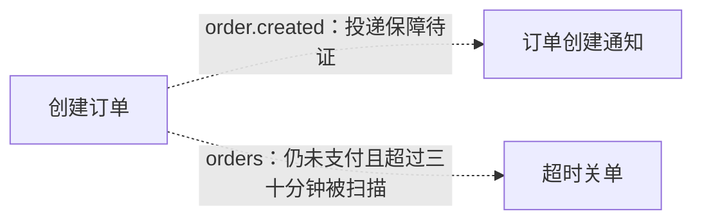
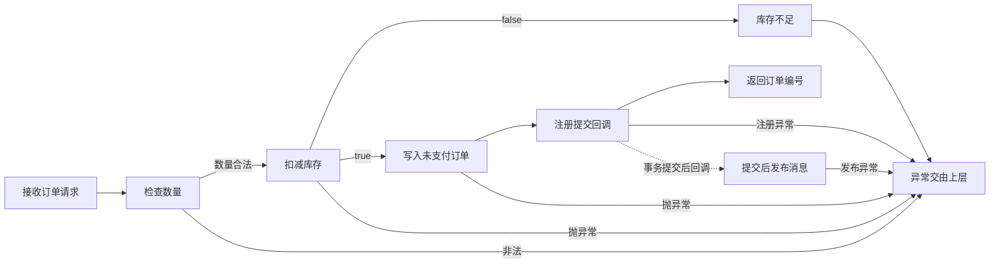
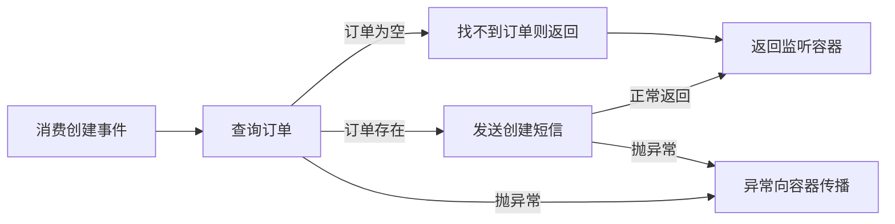
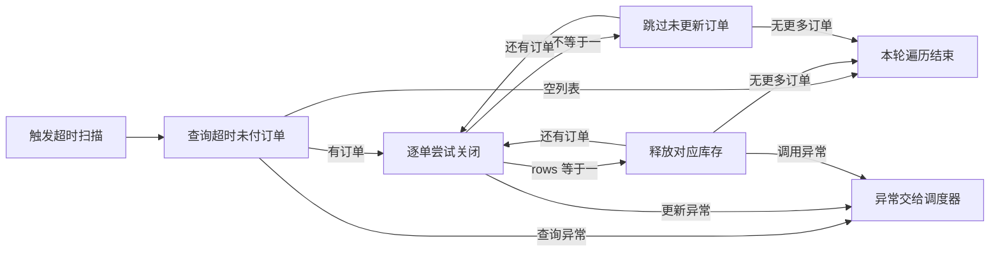

# 人工转交提示词

下面代码块可整体复制给远端 AI，无需另附文件。尚未发送，也未收到回复。正文包含授权公开样例、完整当前稿及全部未决。

~~~~text
你是不能直接访问源码的远端 AI。本地 AI 读源码、发现、补证和落库；你独立质疑材料并组织完整当前图文，用户人工转交与最终验收。不要冒称核实未提供源码或运行过测试。

当前项目、范围、源码基准：公开订单流程样例，全部提供内容为下附 9 文件。没有构建文件、依赖实现和运行环境；SHA-256 基准亦附在下文。用户允许准备这些公开样例的转交文本。当前尚未外发，无历史远端回复。
当前模块与本轮请求：请审查总览及三个关联主体流程的首轮本地待审稿。先质疑，不替本地补造不可得的运行契约。
实际已保存：COVERAGE、STATE、总览、创建订单、订单创建通知、超时关单均已写入知识库，四模块均“梳理中/限制有”。本轮发现对已提供范围暂时收敛，范围整体未完成。

已核实事实：POST /orders 校验数量，调用库存 deduct，写 UNPAID 订单，调用包装器注册 afterCommit 后 publish；监听同名 topic，以 id 查订单，缺失则返回，否则调短信；独立定时任务筛 UNPAID 且早于 30 分钟阈值，条件更新 CLOSED，rows == 1 才 release。下文给出完整代码，而非只给路径。
推断及待核实：按 topic 对应判断预期异步交接，不保证送达。事务实际生效、异常回滚、MQ 配置绑定、投递与确认、短信/库存幂等及超时语义没有证据。不要把 YAML max-retry: 3 写成已证实“恰好重试三次”，也不要把死信主题当成已实现监听入口。
父子与公共契约：总览每节点引用一个主体流程；StockClient/OrderMapper 按具体调用场景内联，没有因名称共享建立公共流程。创建写入 orders 的 UNPAID 与 create_time，超时扫描按相同状态与 create_time<now-30分钟读取，形成条件状态交接；图中不是同步调用。边界详见每模块全文。
外部边界：deduct(skuId,qty) 返回 boolean，false 引发业务异常；release(skuId,qty) 为 void；broker.publish(topic,orderId) 与 smsGateway.send(userId,固定文本) 都缺实现，异常没有本地 catch。不存在可证的跨系统事务或本地补偿保障。
完整未决：下附覆盖表及四模块“未决”是唯一原始记录，共 9 条（8 限制、1 待核实），字段均完整；候选中的引用不另计。请逐条审阅，不能只依据数量判断完成。
上轮问题与补证：无远端上一轮。维护方针对独立首稿指出漏掉状态扫描交接；本地重读写入对象/状态/时间与扫描谓词后补齐，原始遗漏证据保留在评估目录。本地修正了精确证据定位；检查器已知的文本表格识别问题由维护方修复。类型关联问题由维护方修复；最终保持原始分类并复检通过。
实际检查：最新 check.py --json 最终退出码 0，885 项通过、0 失败、0 机械未验证；六条“待核实候选→限制任务”正确关联，派生待办/阻塞为 9/0，与人工原始表对账相符。脚本不证明语义完整、外部契约或完整 Mermaid 语法。四模块没有切换完成状态，没有宣称四项完成闸门已过。所有提供源码已读；没有项目运行测试、完整 Mermaid 自动验证、远端审查或用户召回探针。

请检查遗漏入口/汇点、隐藏条件与出口、粒度、复用边界和证据矛盾。每个问题指出下文文件与位置、影响、所需证据。本地能查的由本地调查；外部未提供材料只写限制，不让用户代查普通代码。特别检查创建返回与提交回调的表达、库存失败一致性、空订单返回与重复消费、关单的 rows 判断及异常中断，以及创建状态进入超时扫描的媒介和条件。

如果提交修改稿，提供完整当前 Markdown：状态、限制、职责、单张 Mermaid、逐节点 ID/标签/短注/去向、规则、候选、实际闸门与未决。不要直接提升正式状态，不要直接联系另一 AI。回复需转交本地的部分放明显独立代码块。

逐文件基准：
{
  "MqProducer.java": "986d5c77dfb248dd060d52681d14c4ed3b60f907e34b829dd85c54be67a81a95",
  "NotifyService.java": "d73d5d37116bf84aaf301749bb1b2f89507aa0e3e9dd812a51113e4c86c66196",
  "OrderController.java": "033d9fd3ac782f099064c9c712ebd0a4ca451a03be628cd2fcff98a381ce1aee",
  "OrderEventListener.java": "d7f1a229e71753ad22aaa1fbbdf383950df6f1f1580742fd65881a96e61dd778",
  "OrderMapper.xml": "aed83b91e8769db181ced3a63a3584db21fc871b6990ade7d3b08097d2835101",
  "OrderService.java": "36ce346dd86b563840e0678ddd3bc332c68faabaaa20ed0a4e945667beba1f3b",
  "OrderTimeoutJob.java": "53dd331c7e995715b4b177904e7d4490492a8ab0a60e2c4511db76dbf70d95ea",
  "StockClient.java": "1b8d965184fcae220411bb4c38b9677c625f607daea91e2b90e73ef4b4c05885",
  "application.yml": "8daeb9cc8d1d3ae2fb846f95e94f5b828aae67e18eb3a38b2db26faf6cd511ea"
}

===== 源码：MqProducer.java =====
  1: @Component
  2: public class MqProducer {
  3:     @Autowired Broker broker;
  4: 
  5:     public void send(String topic, Object payload) {
  6:         TransactionSynchronizationManager.registerSynchronization(new TransactionSynchronization() {
  7:             @Override
  8:             public void afterCommit() {
  9:                 broker.publish(topic, payload);
 10:             }
 11:         });
 12:     }
 13: }

===== 源码：NotifyService.java =====
  1: @Service
  2: public class NotifyService {
  3:     @Autowired SmsGateway smsGateway;
  4:     @Autowired OrderMapper orderMapper;
  5: 
  6:     public void sendCreatedNotice(Long orderId) {
  7:         Order order = orderMapper.selectById(orderId);
  8:         if (order == null) {
  9:             return;
 10:         }
 11:         smsGateway.send(order.getUserId(), "您的订单已创建");
 12:     }
 13: }

===== 源码：OrderController.java =====
  1: @RestController
  2: public class OrderController {
  3:     @Autowired OrderService orderService;
  4: 
  5:     @PostMapping("/orders")
  6:     public Result<Long> create(@RequestBody CreateOrderReq req) {
  7:         Long id = orderService.create(req);
  8:         return Result.ok(id);
  9:     }
 10: }

===== 源码：OrderEventListener.java =====
  1: @Component
  2: public class OrderEventListener {
  3:     @Autowired NotifyService notifyService;
  4: 
  5:     @MqListener(topic = "order.created")
  6:     public void onCreated(Long orderId) {
  7:         notifyService.sendCreatedNotice(orderId);
  8:     }
  9: }

===== 源码：OrderMapper.xml =====
  1: <mapper namespace="demo.order.OrderMapper">
  2:   <insert id="insert" useGeneratedKeys="true" keyProperty="id">
  3:     INSERT INTO orders (user_id, sku_id, qty, status, create_time)
  4:     VALUES (#{userId}, #{skuId}, #{qty}, #{status}, NOW())
  5:   </insert>
  6:   <select id="selectUnpaidBefore" resultType="Order">
  7:     SELECT * FROM orders WHERE status = 'UNPAID' AND create_time &lt; #{before}
  8:   </select>
  9:   <update id="updateStatus">
 10:     UPDATE orders SET status = #{to} WHERE id = #{id} AND status = #{from}
 11:   </update>
 12:   <select id="selectById" resultType="Order">
 13:     SELECT * FROM orders WHERE id = #{id}
 14:   </select>
 15: </mapper>

===== 源码：OrderService.java =====
  1: @Service
  2: public class OrderService {
  3:     @Autowired StockClient stockClient;
  4:     @Autowired OrderMapper orderMapper;
  5:     @Autowired MqProducer mqProducer;
  6: 
  7:     @Transactional
  8:     public Long create(CreateOrderReq req) {
  9:         if (req.getQty() <= 0) {
 10:             throw new BizException("数量非法");
 11:         }
 12:         boolean ok = stockClient.deduct(req.getSkuId(), req.getQty());
 13:         if (!ok) {
 14:             throw new BizException("库存不足");
 15:         }
 16:         Order order = new Order(req.getUserId(), req.getSkuId(), req.getQty(), OrderStatus.UNPAID);
 17:         orderMapper.insert(order);
 18:         mqProducer.send("order.created", order.getId());
 19:         return order.getId();
 20:     }
 21: }

===== 源码：OrderTimeoutJob.java =====
  1: @Component
  2: public class OrderTimeoutJob {
  3:     @Autowired OrderMapper orderMapper;
  4:     @Autowired StockClient stockClient;
  5: 
  6:     @Scheduled(cron = "0 */5 * * * *")
  7:     public void closeTimeoutOrders() {
  8:         List<Order> list = orderMapper.selectUnpaidBefore(LocalDateTime.now().minusMinutes(30));
  9:         for (Order o : list) {
 10:             int rows = orderMapper.updateStatus(o.getId(), OrderStatus.UNPAID, OrderStatus.CLOSED);
 11:             if (rows == 1) {
 12:                 stockClient.release(o.getSkuId(), o.getQty());
 13:             }
 14:         }
 15:     }
 16: }

===== 源码：StockClient.java =====
  1: @FeignClient(name = "stock-service")
  2: public interface StockClient {
  3:     @PostMapping("/stock/deduct")
  4:     boolean deduct(@RequestParam Long skuId, @RequestParam int qty);
  5: 
  6:     @PostMapping("/stock/release")
  7:     void release(@RequestParam Long skuId, @RequestParam int qty);
  8: }

===== 源码：application.yml =====
  1: mq:
  2:   consumer:
  3:     order.created:
  4:       max-retry: 3
  5:       dead-letter: order.created.dlq

===== 完整当前稿：COVERAGE.md =====
# 发现与覆盖

范围：/mnt/ext_drive/workspace/AI workspace/skills/ruan-project-reader/src/tests/fixtures/source 内全部 9 个文件；7 个 Java、1 个 XML、1 个 YAML。当前文件内容 SHA-256 见 ../source-baseline.json。无已提供文件被排除；外部依赖/实现未提供。application.yml 仅可确认声明，不能确认为最终生效配置。
召回探针：未提供，未执行用户独立召回探针。
本轮发现暂时收敛：是
本轮范围整体完成：否

## 入口

| 序号 | 来源位置 | 主体流程 | 总览节点 | 下一步 |
| --- | --- | --- | --- | --- |
| E1 | OrderController.java:5-9 POST /orders | [创建订单](modules/10-创建订单.md) | [A](modules/00-总览.md#A) | 无 |
| E2 | OrderEventListener.java:5-8 @MqListener(order.created) | [订单创建通知](modules/20-订单创建通知.md) | [B](modules/00-总览.md#B) | 无 |
| E3 | OrderTimeoutJob.java:6-15 @Scheduled | [超时关单](modules/30-超时关单.md) | [C](modules/00-总览.md#C) | 无 |

StockClient 的两个 @PostMapping 属于出向 Feign 契约，未误记为本项目服务入口。afterCommit 是创建流程内部回调，放入创建模块；死信仅见配置，没有提供消费入口。

## 汇点

| 序号 | 来源位置 | 定位或孤立候选 | 下一步 |
| --- | --- | --- | --- |
| S1 | OrderService.java:12; StockClient.java:3-4 | [库存扣减](modules/10-创建订单.md#必要规则与源码依据) | 无 |
| S2 | OrderMapper.xml:2-5 | [订单插入](modules/10-创建订单.md#必要规则与源码依据) | 无 |
| S3 | MqProducer.java:6-9 | [消息发布](modules/10-创建订单.md#必要规则与源码依据) | 无 |
| S4 | NotifyService.java:11 | [短信发送](modules/20-订单创建通知.md#必要规则与源码依据) | 无 |
| S5 | OrderMapper.xml:9-11 | [条件关单](modules/30-超时关单.md#必要规则与源码依据) | 无 |
| S6 | StockClient.java:6-7 | [库存释放](modules/30-超时关单.md#必要规则与源码依据) | 无 |

六个汇点都已有归属。归属明确不等于外部副作用成功，边界限制保留在对应模块。

## 发现方法

| 方法或方向 | 适用性 | 扫描范围 | 扫描方法 | 检查对象数 | 未检查区域 | 新增候选数 | 说明 |
| --- | --- | --- | --- | --- | --- | --- | --- |
| 正向入口 | 适用 | 全部 9 文件 | rg -n "Mapping\\|Listener\\|Scheduled\\|Application\\|Bean\\|META-INF\\|cron\\|topic" src/tests/fixtures/source；逐行辨别入口与出向声明 | 9 | 无 | 3 | 计数单位为文件；新增为 E1-E3 三个真实入口，不按命中行计数 |
| 反向汇点 | 适用 | 全部 9 文件 | rg -n "insert\\|update\\|delete\\|send\\|reserve\\|notify\\|rollback\\|transaction\\|retry\\|PAID\\|PENDING\\|CANCEL" src/tests/fixtures/source；全读以补足扣减与释放 | 9 | 无 | 6 | 计数单位为文件；首次登记 S1-S6，DB 读取作为下层候选不当作写副作用 |
| 盲区审查 | 适用 | 全部 9 文件及其声明依赖 | rg --files src/tests/fixtures/source；逐行读全部文件；检索所有 public、注解、接口与配置键 | 9 | 无 | 0 | 提供范围无漏读文件；缺失实现的影响登记于本文件未决，零新增仅限当前可见候选 |

## 交叉复查

| 产生候选的方法或方向 | 交叉复查方法或方向 | 检查范围 | 方法 | 检查对象数 | 新增候选数 | 未检查区域 | 未决去向 |
| --- | --- | --- | --- | --- | --- | --- | --- |
| 正向入口与执行体阅读 | 反向汇点归属核查 | 六个已登记副作用汇点 | 从 SQL/Feign/Broker/SmsGateway 效果逆查调用者，再与 E1-E3 比对；不是重跑入口关键字 | 6 | 0 | 无 | 无新增，已知边界未知保留模块未决 |
| 按调用/消息寻找跨流程关系 | 写入对象与读取谓词对照 | insert、selectUnpaidBefore、updateStatus 三个 SQL 定义 | 逐列比对 orders、UNPAID、create_time=NOW()、before=now-30分钟及条件更新 | 3 | 1 | 无 | 新增状态扫描交接，已解释于总览候选第二行 |
| 逆向状态与时间谓词比对 | 正向创建入口回走与结果归属核查 | 创建、通知、超时三个主体 | 从 create 跟到 UNPAID 持久化与消息注册，分别核对消费和扫描条件；再核对 CLOSED 后无其他已提供消费流程 | 3 | 0 | 无 | 新增关系已处置，无额外新候选；运行边界限制仍保留 |

首次汇点归属复查未新增入口，但漏看了状态媒介；针对性修订新增 1 条创建→定时扫描交接，已更新总览与两端模块。之后使用正向入口回走复查，新增为 0。暂时收敛仅针对当前已提供样例，不证明没有遗漏外部装配。

## 未决

| 来源 | 类型 | 问题 | 下一步 | 已尝试方法 | 缺失依据 | 影响 | 重试条件 |
| --- | --- | --- | --- | --- | --- | --- | --- |
| 盲区审查 | 限制 | 样例缺构建依赖、启动配置、OrderMapper 接口、实体/异常类型、Broker/MqListener/SmsGateway 实现，无法核实实际装配及隐藏入口。 | 在保持当前已提供范围的前提下标明限制；补充实现时重扫装配、入口和汇点。 | rg --files 全量清点，逐行读完全部文件并检索注解、配置、调用与 SQL | 依赖清单及上述实现、全局事务与配置覆盖规则 | 只证明当前样例静态流程，不证明实际部署范围完整；无运行测试条件 | 材料补充或可核查的运行契约出现 |

===== 完整当前稿：STATE.md =====
# 当前工作现场

当前焦点：总览及三份主体流程的首轮本地待审稿；等待远端质疑。
下一步：人工转交 REMOTE-RELAY.md；收到问题后逐项回源码补证，缺失运行契约继续保留限制。
梳理中模块数：4
本层完成模块数：0
已证叶子模块数：0
待办数：9
阻塞数：0
入口数：3
汇点数：6
覆盖记录数：15

待办逐行来自 COVERAGE 1 条、总览 2 条、创建 3 条、通知 2 条、超时关单 1 条，共 9 条；其中 8 条类型限制、1 条待核实。覆盖记录为 3 入口 + 6 汇点 + 3 发现方法 + 3 交叉复查。先读原始记录，再更新此摘要；同模块任务未去重。

===== 完整当前稿：CHECKS.md =====
# 首轮检查记录

本地阅读：9/9 提供文件逐行阅读；3 个入口、6 个重要汇点已映射。发现暂时收敛针对提供范围，保留 8 条范围/契约限制和 1 条远端审查待办。

处置：23 条候选，其中 17 条本文已解释、6 条待核实；待核实各有完整限制记录。完成：4 个模块均梳理中，尚不执行完成或叶子状态迁移；四项完成闸门尚未作为验收证据填报。

机械检查：已执行最新 check.py --json，最终退出码 0，885 项通过、0 失败、0 机械未验证；完整记录见 ../check-final.json。候选“待核实”现可正确关联同来源且有下一步的“限制”记录。派生 9 条任务、0 条阻塞，与人工逐行对账一致。源码语义、发现充分性、外部契约和完整 Mermaid 语法仍在脚本证明范围外。
人工核验：逐行比对入口、写库、条件更新、消息包装回调、空订单返回和异常传播；总览已核实消息与持久化状态两种跨流程交接，定时扫描边写明 UNPAID 及三十分钟条件。外部运行契约、依赖装配与运行结果未验证。
Mermaid：已人工核对节点、短注和关系；command -v mmdc 无输出，未执行完整 Mermaid 语法校验。
项目测试：未运行，提供样例无构建/依赖配置，不能声称运行验证成功。
远端审查：未执行。用户召回探针：未提供，未执行。

本地人工关联复核：六条待核实候选的来源位置和候选名均逐字对应模块未决的来源列；类型采用“限制”因为未提供的运行契约超出本轮源码材料。问题、下一步、已尝试方法、缺失依据、影响和重试条件均已填入。不存在消耗或去重任务。

诊断记录：初次出现普通文本 rg 正则竖线被识别为候选表头，已报告维护方；修复后恢复原始正则形式，此问题不再出现。曾以“阻塞/阻塞”作一次关联能力探针且机械通过，最终恢复原始事实分类，探针结果不是最终稿验收结果。维护方随后修复类型关联，最新最终稿复检通过。

针对性语义修订：首稿把没有直接调用当作排除状态关系的理由，漏掉创建→超时扫描；重新读取三处源码并按修订后的发现参考核查后补入。先登记新增 1 条，再从正向入口及结果归属作不同方向复查，新增 0 条。没有把机械通过当作语义正确证明。

===== 完整当前稿：modules/00-总览.md =====
# 订单样例执行总览
状态：梳理中
限制：有

## 职责与边界

覆盖用户提供的 9 个源码/配置文件。三个主体流程各自有触发条件；创建与通知通过 topic 交接，创建与超时扫描通过持久化状态及时间谓词交接；三个主体仍各自由自身触发器执行。当前只完成首轮本地取证与待审稿，既非已发布业务系统的运行认证，也非范围整体完成。

## 执行图

## 逐节点短注

| 节点 ID | 原标签 | 简短说明 | 去向 |
| --- | --- | --- | --- |
| A | 创建订单 | E1：校验、扣库存、写库并注册消息 | [创建订单](10-创建订单.md) |
| B | 订单创建通知 | E2：查订单并尝试通知用户 | [创建通知](20-订单创建通知.md) |
| C | 超时关单 | E3：条件关单后尝试释放库存 | [超时关单](30-超时关单.md) |

## 必要规则与源码依据

事实：三个节点对应 COVERAGE 的 E1、E2、E3，入口事实只登记在覆盖表。创建流程中 OrderService.java:18 调用 MqProducer.send；MqProducer.java:6-9 在 afterCommit 回调里 publish，接收端 OrderEventListener.java:5-7 使用相同 topic 并将 Long orderId 交给通知服务。

推断：在事务同步、Broker 和监听装配均按名称契约工作时，消息可连接 A 与 B；缺少这些实现，因此图边标明待证，不表示保证送达。

事实：OrderService.java:16-17 写入 UNPAID 订单；OrderMapper.xml:2-5 写入 orders 并令 create_time=NOW()。OrderTimeoutJob.java:8 将本机当前时间减 30 分钟作为 before，OrderMapper.xml:6-8 扫描 orders 中 status=UNPAID 且 create_time<before 的记录。因此 A→C 是持久化状态交接：订单写入可见后，仍为 UNPAID 且满足时间谓词时可被定时流程读取；不是 A 同步调用 C，也不保证一定在特定时刻扫到。数据库与应用时钟关系、调度启用和提交配置仍受现有运行边界限制。

下层图记录异常责任出口，外部一致性和重试仍待证。

## 下钻、引用与外部去向

创建、通知与关单按执行职责各成一份文档。父层可追到子图的本地结果或责任交接；三份子稿的限制会影响保证性陈述，因此总览保持梳理中。StockClient 与 OrderMapper 按调用场景解释，没有足够共同执行语义来单建公共流程。

## 候选记录

扫描范围：仅跨流程交接：消息 publish→listener，以及 OrderService/insert 写入 UNPAID 与 create_time→OrderTimeoutJob/selectUnpaidBefore 按同对象和谓词读取
扫描方法：比对消息 topic/payload；逐项核对 insert 写入列、初始状态、查询谓词和 before 参数，再正向从创建入口复查状态交接；不以无直接调用排除状态媒介
检查对象数：2
未检查区域：无

| 来源位置 | 候选 | 类别 | 数量 | 处置 | 证据或去向 |
| --- | --- | --- | --- | --- | --- |
| MqProducer.java:6-9 → OrderEventListener.java:5-7 | 提交回调消息到监听 | MQ异步后台 | 1 | 本文已解释 | [跨流程证据与限制](#必要规则与源码依据) |
| OrderService.java:16-17; OrderMapper.xml:2-8 → OrderTimeoutJob.java:8 | 未支付订单状态被定时扫描 | 写库缓存状态 | 1 | 本文已解释 | [状态交接条件](#必要规则与源码依据) |

## 未决

| 来源 | 类型 | 问题 | 下一步 | 已尝试方法 | 缺失依据 | 影响 | 重试条件 |
| --- | --- | --- | --- | --- | --- | --- | --- |
| 总览首轮审查 | 待核实 | 尚无远端质疑与补证，全部稿件为本地待审稿。 | 用户可将 REMOTE-RELAY.md 中代码块交远端 AI；收到回复后逐项回源码核实。 | 无 | 无 | 无 | 无 |
| 总览运行边界 | 限制 | 跨流程只有相同 topic 与 payload 的源码证据，真实投递与运行装配未证明。 | 补充 Broker、配置绑定及启动运行契约，复核图中异步关系。 | 读取全部 9 文件，追消息注册、publish 与监听注解 | 消息投递及运行装配契约 | 图中的虚线只表达预期消息责任交接，不能保证消费会发生 | 相关运行契约可取得 |

## 限制说明

见[未决](#未决)中的限制记录；不新增一份任务。

## 核验与下一步

已补核持久化状态媒介，当前总览保留消息与状态扫描两个跨流程候选；各边说明真实触发条件。下一步以总览与关联三份文档做远端质疑。 全部提供文件已逐行本地阅读，尚未经过远端质疑，不切换完成状态。未执行项目运行测试：样例缺少构建文件与依赖实现。Mermaid 节点、分支和边已人工核对；未发现 mmdc，未执行完整 Mermaid 自动语法验证。机械检查结果见[检查记录](../CHECKS.md)。

===== 完整当前稿：modules/10-创建订单.md =====
# 创建订单
状态：梳理中
限制：有

## 职责与边界

从控制器接收 CreateOrderReq 开始，校验数量，调用库存接口，插入 UNPAID 订单，注册提交后的消息发布并返回 id。源码中的业务异常向外抛出；事务拦截器、HTTP 映射和外部服务语义未提供。图分开表示业务方法返回与提交回调，不宣称二者实际时序已经运行验证。

## 执行图

## 逐节点短注

| 节点 ID | 原标签 | 简短说明 | 去向 |
| --- | --- | --- | --- |
| A | 接收订单请求 | 调用 create 并包装成功结果 | 无 |
| B | 检查数量 | 数量小于等于零抛业务异常 | 无 |
| C | 扣减库存 | 传 skuId 与 qty 等待布尔值 | 无 |
| D | 库存不足 | 返回 false 时抛业务异常 | 无 |
| E | 写入未支付订单 | 状态为 UNPAID 并请求回填 id | 无 |
| F | 注册提交回调 | 传入 order.created 和订单 id | 无 |
| G | 返回订单编号 | 业务方法返回后由控制器包装 | 无 |
| H | 提交后发布消息 | 回调 publish 的投递保障未知 | 无 |
| X | 异常交由上层 | 无本地 catch 或显式库存补偿 | 无 |

## 必要规则与源码依据

事实：OrderController.java:5-9 接收 POST /orders，在 orderService.create 返回后调用 Result.ok(id)。请求约束、Result 与全局异常处理未给出，不补写认证或校验逻辑。

汇点精确定位：OrderService.java:12; StockClient.java:3-4，代表本流程的库存扣减调用与接口声明。

事实：OrderService.java:7-20 声明 @Transactional；qty <= 0 抛“数量非法”，deduct 返回 false 抛“库存不足”。OrderService.java:12 与 StockClient.java:1-4 指明 stock-service 的 POST /stock/deduct，参数为 skuId、qty。异常没有本地 catch。

事实：OrderService.java:16-19 构造 UNPAID 订单并 insert；OrderMapper.xml:2-5 写入 user_id、sku_id、qty、status、NOW()，声明 useGeneratedKeys=true、keyProperty=id。数据库类型、表约束及真实回填效果未给出。

事实：OrderService.java:18 调用 MqProducer.send("order.created", order.getId())；MqProducer.java:6-9 注册 TransactionSynchronization.afterCommit，里面 broker.publish(topic,payload)。方法返回与事务回调分别由源码和框架契约决定，不能把“调用 send”画成“消息已送达”。本地没有 outbox、发布重试、发布 catch 的实现；这仅限所给源码。

待核实：事务生效及回滚规则、外部扣减一致性、Broker 确认和投递，均见未决。没有依据断言支付流程或订单最终 CLOSED。

## 下钻、引用与外部去向

引用[通知消费](20-订单创建通知.md)：发送的 topic 与监听注解相同，输入为订单 id；仅在消息真实投递后才进入消费，协议与投递保障未证实。另以持久化状态交给[超时关单](30-超时关单.md)：写入 orders 的 UNPAID 与 create_time，在仍未支付且早于扫描 before 时可被独立定时入口读取；并非同步调用。库存调用在本流程只有 deduct；release 属于独立定时流程，不能当作 create 异常的补偿。

## 候选记录

扫描范围：OrderController.create、OrderService.create、MqProducer.send/afterCommit、StockClient.deduct、OrderMapper.insert 的全部已提供执行体与定义
扫描方法：逐行阅读上述文件；rg -n "create|deduct|insert|send|afterCommit|publish|Transactional|throw" src/tests/fixtures/source
检查对象数：9
未检查区域：无

| 来源位置 | 候选 | 类别 | 数量 | 处置 | 证据或去向 |
| --- | --- | --- | --- | --- | --- |
| OrderController.java:7-8 | 调用与成功返回 | 出向调用 | 1 | 本文已解释 | [规则](#必要规则与源码依据) |
| OrderService.java:7 | 事务注解及异常边界 | 事务锁并发 | 1 | 待核实 | [事务限制](#未决) |
| OrderService.java:9-10 | 数量校验拒绝 | 权限判断算法 | 1 | 本文已解释 | [数量判断](#B) |
| StockClient.java:3-4 | 扣减库存契约 | 外部调用副作用 | 1 | 待核实 | [库存限制](#未决) |
| OrderService.java:12-15 | 库存失败拒绝 | 异常重试补偿 | 1 | 本文已解释 | [失败分支](#D) |
| OrderService.java:16-17; OrderMapper.xml:2-5 | 插入未支付订单 | 写库缓存状态 | 1 | 本文已解释 | [写库](#必要规则与源码依据) |
| OrderService.java:18 | 把订单 id 交给消息包装器 | MQ异步后台 | 1 | 本文已解释 | [注册回调](#F) |
| MqProducer.java:6-9 | 提交回调发布 | MQ异步后台 | 1 | 待核实 | [发布限制](#未决) |
| OrderService.java:8-20 | 异常无本地补偿 | 异常重试补偿 | 1 | 本文已解释 | [异常出口](#X) |

## 未决

| 来源 | 类型 | 问题 | 下一步 | 已尝试方法 | 缺失依据 | 影响 | 重试条件 |
| --- | --- | --- | --- | --- | --- | --- | --- |
| OrderService.java:7 / 事务注解及异常边界 | 限制 | 只有 @Transactional 声明；缺事务装配、BizException 继承和异常映射，不能断言所有异常回滚及 HTTP 错误码。 | 取得依赖与异常定义后核实代理、事务提交回滚及错误映射。 | 逐行阅读全部 9 文件并检索 Transactional、Exception、配置 | 事务管理器、异常类型与 HTTP 处理实现 | 无法保证写库回滚、接口最终结果和提交后异常的关系 | 补充这些实现或明确运行时契约 |
| StockClient.java:3-4 / 扣减库存契约 | 限制 | 接口只给 boolean；远端扣减、幂等、超时重试与补偿不可知。 | 查库存服务契约及 Feign 配置；核实扣减成功后写库失败的库存处置。 | 阅读 StockClient 和 create 全执行体，检索 release 调用 | 库存实现、错误及幂等契约、客户端重试配置 | 扣减异常及写库失败可能留下何种库存状态未知 | 可获得外部契约或相关实现 |
| MqProducer.java:6-9 / 提交回调发布 | 限制 | 源码仅注册 afterCommit 并调用 publish；Broker 的确认、重试、投递及失败语义未知。 | 补 Broker 与事务同步契约，核实注册失败、发布失败、消费可达性及重投。 | 逐行阅读 producer、listener、配置并搜索 publish | Broker 实现、事务同步运行配置、发布失败处理契约 | 不能保证数据库写入后消息一定送达，也不能保证发布失败时调用方结果 | 提供 Broker 和事务运行契约 |

## 限制说明

见[未决](#未决)中的限制记录；不新增一份任务。

## 核验与下一步

已追过控制器与消息包装器，到实际 insert 和 publish；按执行职责内联，避免为两个薄包装另建文档。下一步先接收远端质疑，再在获得运行时材料时补三项边界。 全部提供文件已逐行本地阅读，尚未经过远端质疑，不切换完成状态。未执行项目运行测试：样例缺少构建文件与依赖实现。Mermaid 节点、分支和边已人工核对；未发现 mmdc，未执行完整 Mermaid 自动语法验证。机械检查结果见[检查记录](../CHECKS.md)。

===== 完整当前稿：modules/20-订单创建通知.md =====
# 订单创建通知
状态：梳理中
限制：有

## 职责与边界

监听 order.created，接收 Long orderId，查找订单；订单不存在则直接返回，否则调用短信网关通知订单所属用户。消息何时到达、确认与重复消费不由这些代码完整定义。

## 执行图

## 逐节点短注

| 节点 ID | 原标签 | 简短说明 | 去向 |
| --- | --- | --- | --- |
| A | 消费创建事件 | 传入订单 id 并调用通知服务 | 无 |
| B | 查询订单 | 按 id 查询完整订单记录 | 无 |
| C | 找不到订单则返回 | 直接结束且不发送短信 | 无 |
| D | 发送创建短信 | 给订单用户发送固定文案 | 无 |
| E | 返回监听容器 | 容器确认与重试方式未知 | 无 |
| X | 异常向容器传播 | 没有局部异常捕获 | 无 |

## 必要规则与源码依据

事实：OrderEventListener.java:5-8 的 @MqListener(topic="order.created") 调用 notifyService.sendCreatedNotice(orderId)。NotifyService.java:7-11 先 selectById，null 则 return；存在则 smsGateway.send(order.getUserId(), "您的订单已创建")。OrderMapper.xml:12-14 的查询仅按 id，没有状态过滤，因此已 CLOSED 记录也不被这段代码排除。

汇点精确定位：NotifyService.java:11，发送对象是 order.getUserId()，文案固定为“您的订单已创建”。

事实：NotifyService.java:6-12 无本地 catch，也没有发送标记、去重或本地重试。未提供的网关或框架可能另有机制，不能推断必然重复。

事实：application.yml:1-5 声明 mq.consumer.order.created 下 max-retry: 3 与 dead-letter: order.created.dlq。未提供绑定实现，不能把配置文字升级成已经生效的重试图，也不把死信主题误记为已实现的新入口。

待核实：是否存在事务/ack、次数的含义、异常后重投、短信副作用，见未决。

## 下钻、引用与外部去向

上游[创建订单](10-创建订单.md) 以相同 topic 发布订单 id；消费图从消息实际进入监听器才开始。SmsGateway 输入为数据库读取的 userId 与固定文案，返回类型和外部结果未知；未提供契约，保留待核实。OrderMapper 被两个业务场景使用，但具体 SQL 语义不同，当前分别内联，不仅为共享名称抽公共模块。

## 候选记录

扫描范围：OrderEventListener.onCreated、NotifyService.sendCreatedNotice、OrderMapper.selectById 和 application.yml 全部提供内容
扫描方法：逐行读取；rg -n "onCreated|sendCreatedNotice|selectById|smsGateway|retry|dead-letter" src/tests/fixtures/source
检查对象数：6
未检查区域：无

| 来源位置 | 候选 | 类别 | 数量 | 处置 | 证据或去向 |
| --- | --- | --- | --- | --- | --- |
| OrderEventListener.java:5-7 | 消费创建事件 | MQ异步后台 | 1 | 本文已解释 | [消费入口](#A) |
| NotifyService.java:7; OrderMapper.xml:12-14 | 订单查询 | 出向调用 | 1 | 本文已解释 | [查询依据](#必要规则与源码依据) |
| NotifyService.java:8-10 | 空订单返回 | 其他 | 1 | 本文已解释 | [空结果](#C) |
| NotifyService.java:11 | 发送创建短信 | 外部调用副作用 | 1 | 待核实 | [网关限制](#未决) |
| application.yml:1-5 | 消费重试与死信配置 | 配置分派 | 1 | 待核实 | [配置限制](#未决) |
| NotifyService.java:6-12 | 异常传播及无本地去重 | 异常重试补偿 | 1 | 本文已解释 | [异常出口](#X) |

## 未决

| 来源 | 类型 | 问题 | 下一步 | 已尝试方法 | 缺失依据 | 影响 | 重试条件 |
| --- | --- | --- | --- | --- | --- | --- | --- |
| application.yml:1-5 / 消费重试与死信配置 | 限制 | 有 max-retry=3 和 dead-letter，但无配置绑定、确认模式与监听容器实现。 | 取得 MQ 配置绑定、ack/nack 和重试契约后核实次数含义、失败后死信及幂等。 | 读 listener、NotifyService、YAML 并全范围检索 retry、dead-letter、MqListener | MQ 绑定与消费容器实现 | 不能保证失败会重试三次、一定入死信或至多发一条短信 | 补充 MQ 运行时契约或实现 |
| NotifyService.java:11 / 发送创建短信 | 限制 | SmsGateway 只有调用点，没有成功、失败、超时及幂等契约。 | 补网关接口与实现，核实短信异常传播和重复发送影响。 | 逐行阅读 NotifyService 并搜索 SmsGateway、send | 短信网关接口、错误与幂等约定 | 只能确认尝试调用短信发送，不能断言用户已收到 | 取得 SmsGateway 契约或实现 |

## 限制说明

见[未决](#未决)中的限制记录；不新增一份任务。

## 核验与下一步

已查明缺订单的静默返回以及不按订单状态过滤；下一步核实远端对重试和幂等的质疑。 全部提供文件已逐行本地阅读，尚未经过远端质疑，不切换完成状态。未执行项目运行测试：样例缺少构建文件与依赖实现。Mermaid 节点、分支和边已人工核对；未发现 mmdc，未执行完整 Mermaid 自动语法验证。机械检查结果见[检查记录](../CHECKS.md)。

===== 完整当前稿：modules/30-超时关单.md =====
# 超时关单
状态：梳理中
限制：有

## 职责与边界

定时方法查询超过 30 分钟的 UNPAID 订单，遍历并以旧状态条件更新为 CLOSED，仅 update 返回 1 时调用库存释放。当前方法没有 @Transactional 或局部 catch；调度是否启用、实际时区和全局拦截行为未提供。

## 执行图

## 逐节点短注

| 节点 ID | 原标签 | 简短说明 | 去向 |
| --- | --- | --- | --- |
| A | 触发超时扫描 | cron 声明每五分钟触发 | 无 |
| B | 查询超时未付订单 | 早于本机当前时间减三十分钟 | 无 |
| C | 逐单尝试关闭 | 更新条件含 id 与 UNPAID | 无 |
| D | 释放对应库存 | 仅更新一行时传 skuId 与 qty | 无 |
| E | 跳过未更新订单 | 非一行时不调用库存释放 | 无 |
| F | 本轮遍历结束 | 无更多订单则方法结束 | 无 |
| X | 异常交给调度器 | 方法无 catch 或局部重试 | 无 |

## 必要规则与源码依据

事实：OrderTimeoutJob.java:6-8 声明 cron="0 */5 * * * *"，查询参数为 LocalDateTime.now().minusMinutes(30)。OrderMapper.xml:6-8 条件是 status = UNPAID 且 create_time < before，不含等于。cron 的五分钟含义是基于通常的六字段解释；未提供真实调度启用和时区配置，不声称已经定时运行。

事实：OrderTimeoutJob.java:9-13 遍历结果，updateStatus(id,UNPAID,CLOSED)，rows == 1 才 release(skuId,qty)。OrderMapper.xml:9-11 的 UPDATE 同时匹配 id 与旧状态，SQL 有条件写入；不能仅凭 SQL 断言完整并发和事务语义。

事实：StockClient.java:6-7 定义 stock-service 的 POST /stock/release，返回 void。调用返回不等于业务释放成功的已证结果。源码顺序是先更新状态，再调用释放，当前 job 无 catch；任一调用抛异常会使当前方法退出，后续订单不会由本次调用继续处理。框架如何捕获、以后是否重跑未知。

待核实：数据库提交时机、释放失败后的补偿、外部幂等与调度实际生效，见未决和 COVERAGE 范围限制。

## 下钻、引用与外部去向

本流程由调度触发；[创建订单](10-创建订单.md) 写入 orders、UNPAID 与 create_time=NOW()，本流程按 UNPAID 与 create_time<now-30分钟读取，形成有条件的持久化状态交接。只有写入可见、状态仍匹配且达到时间条件时该记录才可能进入本流程，不是同步调用。库存 release 与创建流程 deduct 只共享客户端名称，输入和外部行为不同，当前不抽公共模块。

## 候选记录

扫描范围：OrderTimeoutJob.closeTimeoutOrders、OrderMapper.selectUnpaidBefore/updateStatus、StockClient.release 全部提供内容
扫描方法：逐行读取；rg -n "Scheduled|selectUnpaidBefore|updateStatus|release|rows|minusMinutes" src/tests/fixtures/source
检查对象数：6
未检查区域：无

| 来源位置 | 候选 | 类别 | 数量 | 处置 | 证据或去向 |
| --- | --- | --- | --- | --- | --- |
| OrderTimeoutJob.java:6-8 | 调度及超时筛选 | MQ异步后台 | 1 | 本文已解释 | [触发与条件](#必要规则与源码依据) |
| OrderTimeoutJob.java:9 | 遍历每条订单 | 其他 | 1 | 本文已解释 | [逐单处理](#C) |
| OrderTimeoutJob.java:10; OrderMapper.xml:9-11 | 按旧状态条件关单 | 写库缓存状态 | 1 | 本文已解释 | [条件写库](#必要规则与源码依据) |
| OrderTimeoutJob.java:11 | 仅更新一行才释放 | 权限判断算法 | 1 | 本文已解释 | [分支](#D) |
| OrderTimeoutJob.java:10-12; StockClient.java:6-7 | 关单后释放库存 | 外部调用副作用 | 1 | 待核实 | [库存一致性限制](#未决) |
| OrderTimeoutJob.java:7-15 | 异常结束本轮执行 | 异常重试补偿 | 1 | 本文已解释 | [异常出口](#X) |

## 未决

| 来源 | 类型 | 问题 | 下一步 | 已尝试方法 | 缺失依据 | 影响 | 重试条件 |
| --- | --- | --- | --- | --- | --- | --- | --- |
| OrderTimeoutJob.java:10-12; StockClient.java:6-7 / 关单后释放库存 | 限制 | 状态更新在释放调用之前；释放失败、重复调用和跨实例并发下的一致性契约缺失。 | 取得事务/mapper 运行配置与库存 release 契约，核实 update 返回值、提交时机、幂等、重试或补偿。 | 阅读 job、SQL、Feign 接口；全范围搜索 release、Transactional、try、catch | 事务与数据库运行配置、release 错误及幂等契约 | 不能证明 CLOSED 与已释放总是一致；释放异常时剩余订单处理会退出当前方法，但调度容器后续处理未知 | 补充运行配置与库存契约 |

## 限制说明

见[未决](#未决)中的限制记录；不新增一份任务。

## 核验与下一步

已核实严格早于阈值、条件更新、rows 分支及异常打断遍历；下一步核实库存释放契约和远端质疑。 全部提供文件已逐行本地阅读，尚未经过远端质疑，不切换完成状态。未执行项目运行测试：样例缺少构建文件与依赖实现。Mermaid 节点、分支和边已人工核对；未发现 mmdc，未执行完整 Mermaid 自动语法验证。机械检查结果见[检查记录](../CHECKS.md)。

下一步：返回具体质疑；本地逐条补证。证据充分的部分可明确确认，不为形式制造问题。外部运行契约仍缺失时保留限制，不能据机械检查或双方认可断言整体完整。
~~~~
