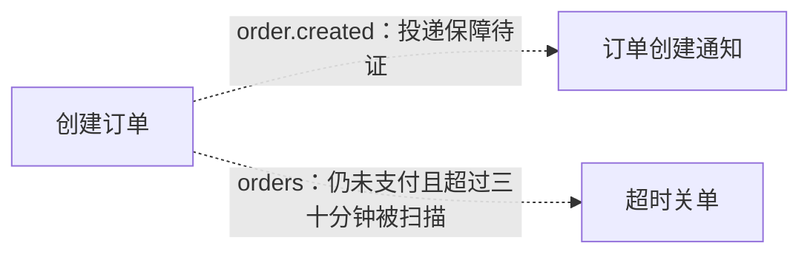

# 订单样例执行总览
状态：梳理中
限制：有

## 职责与边界

覆盖用户提供的 9 个源码/配置文件。三个主体流程各自有触发条件；创建与通知通过 topic 交接，创建与超时扫描通过持久化状态及时间谓词交接；三个主体仍各自由自身触发器执行。当前只完成首轮本地取证与待审稿，既非已发布业务系统的运行认证，也非范围整体完成。

## 执行图

## 逐节点短注

| 节点 ID | 原标签 | 简短说明 | 去向 |
| --- | --- | --- | --- |
| A | 创建订单 | E1：校验、扣库存、写库并注册消息 | [创建订单](10-创建订单.md) |
| B | 订单创建通知 | E2：查订单并尝试通知用户 | [创建通知](20-订单创建通知.md) |
| C | 超时关单 | E3：条件关单后尝试释放库存 | [超时关单](30-超时关单.md) |

## 必要规则与源码依据

事实：三个节点对应 COVERAGE 的 E1、E2、E3，入口事实只登记在覆盖表。创建流程中 OrderService.java:18 调用 MqProducer.send；MqProducer.java:6-9 在 afterCommit 回调里 publish，接收端 OrderEventListener.java:5-7 使用相同 topic 并将 Long orderId 交给通知服务。

推断：在事务同步、Broker 和监听装配均按名称契约工作时，消息可连接 A 与 B；缺少这些实现，因此图边标明待证，不表示保证送达。

事实：OrderService.java:16-17 写入 UNPAID 订单；OrderMapper.xml:2-5 写入 orders 并令 create_time=NOW()。OrderTimeoutJob.java:8 将本机当前时间减 30 分钟作为 before，OrderMapper.xml:6-8 扫描 orders 中 status=UNPAID 且 create_time<before 的记录。因此 A→C 是持久化状态交接：订单写入可见后，仍为 UNPAID 且满足时间谓词时可被定时流程读取；不是 A 同步调用 C，也不保证一定在特定时刻扫到。数据库与应用时钟关系、调度启用和提交配置仍受现有运行边界限制。

下层图记录异常责任出口，外部一致性和重试仍待证。

## 下钻、引用与外部去向

创建、通知与关单按执行职责各成一份文档。父层可追到子图的本地结果或责任交接；三份子稿的限制会影响保证性陈述，因此总览保持梳理中。StockClient 与 OrderMapper 按调用场景解释，没有足够共同执行语义来单建公共流程。

## 候选记录

扫描范围：仅跨流程交接：消息 publish→listener，以及 OrderService/insert 写入 UNPAID 与 create_time→OrderTimeoutJob/selectUnpaidBefore 按同对象和谓词读取
扫描方法：比对消息 topic/payload；逐项核对 insert 写入列、初始状态、查询谓词和 before 参数，再正向从创建入口复查状态交接；不以无直接调用排除状态媒介
检查对象数：2
未检查区域：无

| 来源位置 | 候选 | 类别 | 数量 | 处置 | 证据或去向 |
| --- | --- | --- | --- | --- | --- |
| MqProducer.java:6-9 → OrderEventListener.java:5-7 | 提交回调消息到监听 | MQ异步后台 | 1 | 本文已解释 | [跨流程证据与限制](#必要规则与源码依据) |
| OrderService.java:16-17; OrderMapper.xml:2-8 → OrderTimeoutJob.java:8 | 未支付订单状态被定时扫描 | 写库缓存状态 | 1 | 本文已解释 | [状态交接条件](#必要规则与源码依据) |

## 未决

| 来源 | 类型 | 问题 | 下一步 | 已尝试方法 | 缺失依据 | 影响 | 重试条件 |
| --- | --- | --- | --- | --- | --- | --- | --- |
| 总览首轮审查 | 待核实 | 尚无远端质疑与补证，全部稿件为本地待审稿。 | 用户可将 REMOTE-RELAY.md 中代码块交远端 AI；收到回复后逐项回源码核实。 | 无 | 无 | 无 | 无 |
| 总览运行边界 | 限制 | 跨流程只有相同 topic 与 payload 的源码证据，真实投递与运行装配未证明。 | 补充 Broker、配置绑定及启动运行契约，复核图中异步关系。 | 读取全部 9 文件，追消息注册、publish 与监听注解 | 消息投递及运行装配契约 | 图中的虚线只表达预期消息责任交接，不能保证消费会发生 | 相关运行契约可取得 |

## 限制说明

见[未决](#未决)中的限制记录；不新增一份任务。

## 核验与下一步

已补核持久化状态媒介，当前总览保留消息与状态扫描两个跨流程候选；各边说明真实触发条件。下一步以总览与关联三份文档做远端质疑。 全部提供文件已逐行本地阅读，尚未经过远端质疑，不切换完成状态。未执行项目运行测试：样例缺少构建文件与依赖实现。Mermaid 节点、分支和边已人工核对；未发现 mmdc，未执行完整 Mermaid 自动语法验证。机械检查结果见[检查记录](../CHECKS.md)。
