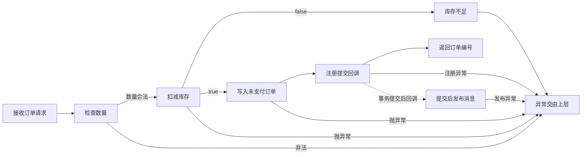

# 创建订单
状态：梳理中
限制：有

## 职责与边界

从控制器接收 CreateOrderReq 开始，校验数量，调用库存接口，插入 UNPAID 订单，注册提交后的消息发布并返回 id。源码中的业务异常向外抛出；事务拦截器、HTTP 映射和外部服务语义未提供。图分开表示业务方法返回与提交回调，不宣称二者实际时序已经运行验证。

## 执行图

## 逐节点短注

| 节点 ID | 原标签 | 简短说明 | 去向 |
| --- | --- | --- | --- |
| A | 接收订单请求 | 调用 create 并包装成功结果 | 无 |
| B | 检查数量 | 数量小于等于零抛业务异常 | 无 |
| C | 扣减库存 | 传 skuId 与 qty 等待布尔值 | 无 |
| D | 库存不足 | 返回 false 时抛业务异常 | 无 |
| E | 写入未支付订单 | 状态为 UNPAID 并请求回填 id | 无 |
| F | 注册提交回调 | 传入 order.created 和订单 id | 无 |
| G | 返回订单编号 | 业务方法返回后由控制器包装 | 无 |
| H | 提交后发布消息 | 回调 publish 的投递保障未知 | 无 |
| X | 异常交由上层 | 无本地 catch 或显式库存补偿 | 无 |

## 必要规则与源码依据

事实：OrderController.java:5-9 接收 POST /orders，在 orderService.create 返回后调用 Result.ok(id)。请求约束、Result 与全局异常处理未给出，不补写认证或校验逻辑。

汇点精确定位：OrderService.java:12; StockClient.java:3-4，代表本流程的库存扣减调用与接口声明。

事实：OrderService.java:7-20 声明 @Transactional；qty <= 0 抛“数量非法”，deduct 返回 false 抛“库存不足”。OrderService.java:12 与 StockClient.java:1-4 指明 stock-service 的 POST /stock/deduct，参数为 skuId、qty。异常没有本地 catch。

事实：OrderService.java:16-19 构造 UNPAID 订单并 insert；OrderMapper.xml:2-5 写入 user_id、sku_id、qty、status、NOW()，声明 useGeneratedKeys=true、keyProperty=id。数据库类型、表约束及真实回填效果未给出。

事实：OrderService.java:18 调用 MqProducer.send("order.created", order.getId())；MqProducer.java:6-9 注册 TransactionSynchronization.afterCommit，里面 broker.publish(topic,payload)。方法返回与事务回调分别由源码和框架契约决定，不能把“调用 send”画成“消息已送达”。本地没有 outbox、发布重试、发布 catch 的实现；这仅限所给源码。

待核实：事务生效及回滚规则、外部扣减一致性、Broker 确认和投递，均见未决。没有依据断言支付流程或订单最终 CLOSED。

## 下钻、引用与外部去向

引用[通知消费](20-订单创建通知.md)：发送的 topic 与监听注解相同，输入为订单 id；仅在消息真实投递后才进入消费，协议与投递保障未证实。另以持久化状态交给[超时关单](30-超时关单.md)：写入 orders 的 UNPAID 与 create_time，在仍未支付且早于扫描 before 时可被独立定时入口读取；并非同步调用。库存调用在本流程只有 deduct；release 属于独立定时流程，不能当作 create 异常的补偿。

## 候选记录

扫描范围：OrderController.create、OrderService.create、MqProducer.send/afterCommit、StockClient.deduct、OrderMapper.insert 的全部已提供执行体与定义
扫描方法：逐行阅读上述文件；rg -n "create|deduct|insert|send|afterCommit|publish|Transactional|throw" src/tests/fixtures/source
检查对象数：9
未检查区域：无

| 来源位置 | 候选 | 类别 | 数量 | 处置 | 证据或去向 |
| --- | --- | --- | --- | --- | --- |
| OrderController.java:7-8 | 调用与成功返回 | 出向调用 | 1 | 本文已解释 | [规则](#必要规则与源码依据) |
| OrderService.java:7 | 事务注解及异常边界 | 事务锁并发 | 1 | 待核实 | [事务限制](#未决) |
| OrderService.java:9-10 | 数量校验拒绝 | 权限判断算法 | 1 | 本文已解释 | [数量判断](#B) |
| StockClient.java:3-4 | 扣减库存契约 | 外部调用副作用 | 1 | 待核实 | [库存限制](#未决) |
| OrderService.java:12-15 | 库存失败拒绝 | 异常重试补偿 | 1 | 本文已解释 | [失败分支](#D) |
| OrderService.java:16-17; OrderMapper.xml:2-5 | 插入未支付订单 | 写库缓存状态 | 1 | 本文已解释 | [写库](#必要规则与源码依据) |
| OrderService.java:18 | 把订单 id 交给消息包装器 | MQ异步后台 | 1 | 本文已解释 | [注册回调](#F) |
| MqProducer.java:6-9 | 提交回调发布 | MQ异步后台 | 1 | 待核实 | [发布限制](#未决) |
| OrderService.java:8-20 | 异常无本地补偿 | 异常重试补偿 | 1 | 本文已解释 | [异常出口](#X) |

## 未决

| 来源 | 类型 | 问题 | 下一步 | 已尝试方法 | 缺失依据 | 影响 | 重试条件 |
| --- | --- | --- | --- | --- | --- | --- | --- |
| OrderService.java:7 / 事务注解及异常边界 | 限制 | 只有 @Transactional 声明；缺事务装配、BizException 继承和异常映射，不能断言所有异常回滚及 HTTP 错误码。 | 取得依赖与异常定义后核实代理、事务提交回滚及错误映射。 | 逐行阅读全部 9 文件并检索 Transactional、Exception、配置 | 事务管理器、异常类型与 HTTP 处理实现 | 无法保证写库回滚、接口最终结果和提交后异常的关系 | 补充这些实现或明确运行时契约 |
| StockClient.java:3-4 / 扣减库存契约 | 限制 | 接口只给 boolean；远端扣减、幂等、超时重试与补偿不可知。 | 查库存服务契约及 Feign 配置；核实扣减成功后写库失败的库存处置。 | 阅读 StockClient 和 create 全执行体，检索 release 调用 | 库存实现、错误及幂等契约、客户端重试配置 | 扣减异常及写库失败可能留下何种库存状态未知 | 可获得外部契约或相关实现 |
| MqProducer.java:6-9 / 提交回调发布 | 限制 | 源码仅注册 afterCommit 并调用 publish；Broker 的确认、重试、投递及失败语义未知。 | 补 Broker 与事务同步契约，核实注册失败、发布失败、消费可达性及重投。 | 逐行阅读 producer、listener、配置并搜索 publish | Broker 实现、事务同步运行配置、发布失败处理契约 | 不能保证数据库写入后消息一定送达，也不能保证发布失败时调用方结果 | 提供 Broker 和事务运行契约 |

## 限制说明

见[未决](#未决)中的限制记录；不新增一份任务。

## 核验与下一步

已追过控制器与消息包装器，到实际 insert 和 publish；按执行职责内联，避免为两个薄包装另建文档。下一步先接收远端质疑，再在获得运行时材料时补三项边界。 全部提供文件已逐行本地阅读，尚未经过远端质疑，不切换完成状态。未执行项目运行测试：样例缺少构建文件与依赖实现。Mermaid 节点、分支和边已人工核对；未发现 mmdc，未执行完整 Mermaid 自动语法验证。机械检查结果见[检查记录](../CHECKS.md)。
