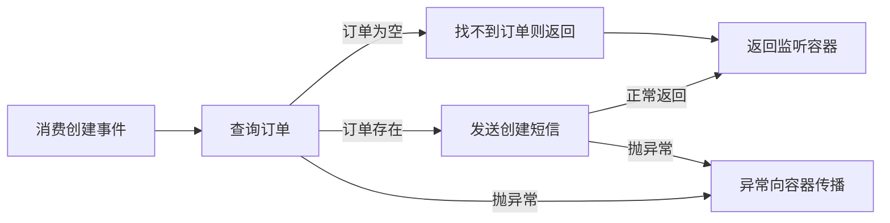

# 订单创建通知
状态：梳理中
限制：有

## 职责与边界

监听 order.created，接收 Long orderId，查找订单；订单不存在则直接返回，否则调用短信网关通知订单所属用户。消息何时到达、确认与重复消费不由这些代码完整定义。

## 执行图

## 逐节点短注

| 节点 ID | 原标签 | 简短说明 | 去向 |
| --- | --- | --- | --- |
| A | 消费创建事件 | 传入订单 id 并调用通知服务 | 无 |
| B | 查询订单 | 按 id 查询完整订单记录 | 无 |
| C | 找不到订单则返回 | 直接结束且不发送短信 | 无 |
| D | 发送创建短信 | 给订单用户发送固定文案 | 无 |
| E | 返回监听容器 | 容器确认与重试方式未知 | 无 |
| X | 异常向容器传播 | 没有局部异常捕获 | 无 |

## 必要规则与源码依据

事实：OrderEventListener.java:5-8 的 @MqListener(topic="order.created") 调用 notifyService.sendCreatedNotice(orderId)。NotifyService.java:7-11 先 selectById，null 则 return；存在则 smsGateway.send(order.getUserId(), "您的订单已创建")。OrderMapper.xml:12-14 的查询仅按 id，没有状态过滤，因此已 CLOSED 记录也不被这段代码排除。

汇点精确定位：NotifyService.java:11，发送对象是 order.getUserId()，文案固定为“您的订单已创建”。

事实：NotifyService.java:6-12 无本地 catch，也没有发送标记、去重或本地重试。未提供的网关或框架可能另有机制，不能推断必然重复。

事实：application.yml:1-5 声明 mq.consumer.order.created 下 max-retry: 3 与 dead-letter: order.created.dlq。未提供绑定实现，不能把配置文字升级成已经生效的重试图，也不把死信主题误记为已实现的新入口。

待核实：是否存在事务/ack、次数的含义、异常后重投、短信副作用，见未决。

## 下钻、引用与外部去向

上游[创建订单](10-创建订单.md) 以相同 topic 发布订单 id；消费图从消息实际进入监听器才开始。SmsGateway 输入为数据库读取的 userId 与固定文案，返回类型和外部结果未知；未提供契约，保留待核实。OrderMapper 被两个业务场景使用，但具体 SQL 语义不同，当前分别内联，不仅为共享名称抽公共模块。

## 候选记录

扫描范围：OrderEventListener.onCreated、NotifyService.sendCreatedNotice、OrderMapper.selectById 和 application.yml 全部提供内容
扫描方法：逐行读取；rg -n "onCreated|sendCreatedNotice|selectById|smsGateway|retry|dead-letter" src/tests/fixtures/source
检查对象数：6
未检查区域：无

| 来源位置 | 候选 | 类别 | 数量 | 处置 | 证据或去向 |
| --- | --- | --- | --- | --- | --- |
| OrderEventListener.java:5-7 | 消费创建事件 | MQ异步后台 | 1 | 本文已解释 | [消费入口](#A) |
| NotifyService.java:7; OrderMapper.xml:12-14 | 订单查询 | 出向调用 | 1 | 本文已解释 | [查询依据](#必要规则与源码依据) |
| NotifyService.java:8-10 | 空订单返回 | 其他 | 1 | 本文已解释 | [空结果](#C) |
| NotifyService.java:11 | 发送创建短信 | 外部调用副作用 | 1 | 待核实 | [网关限制](#未决) |
| application.yml:1-5 | 消费重试与死信配置 | 配置分派 | 1 | 待核实 | [配置限制](#未决) |
| NotifyService.java:6-12 | 异常传播及无本地去重 | 异常重试补偿 | 1 | 本文已解释 | [异常出口](#X) |

## 未决

| 来源 | 类型 | 问题 | 下一步 | 已尝试方法 | 缺失依据 | 影响 | 重试条件 |
| --- | --- | --- | --- | --- | --- | --- | --- |
| application.yml:1-5 / 消费重试与死信配置 | 限制 | 有 max-retry=3 和 dead-letter，但无配置绑定、确认模式与监听容器实现。 | 取得 MQ 配置绑定、ack/nack 和重试契约后核实次数含义、失败后死信及幂等。 | 读 listener、NotifyService、YAML 并全范围检索 retry、dead-letter、MqListener | MQ 绑定与消费容器实现 | 不能保证失败会重试三次、一定入死信或至多发一条短信 | 补充 MQ 运行时契约或实现 |
| NotifyService.java:11 / 发送创建短信 | 限制 | SmsGateway 只有调用点，没有成功、失败、超时及幂等契约。 | 补网关接口与实现，核实短信异常传播和重复发送影响。 | 逐行阅读 NotifyService 并搜索 SmsGateway、send | 短信网关接口、错误与幂等约定 | 只能确认尝试调用短信发送，不能断言用户已收到 | 取得 SmsGateway 契约或实现 |

## 限制说明

见[未决](#未决)中的限制记录；不新增一份任务。

## 核验与下一步

已查明缺订单的静默返回以及不按订单状态过滤；下一步核实远端对重试和幂等的质疑。 全部提供文件已逐行本地阅读，尚未经过远端质疑，不切换完成状态。未执行项目运行测试：样例缺少构建文件与依赖实现。Mermaid 节点、分支和边已人工核对；未发现 mmdc，未执行完整 Mermaid 自动语法验证。机械检查结果见[检查记录](../CHECKS.md)。
