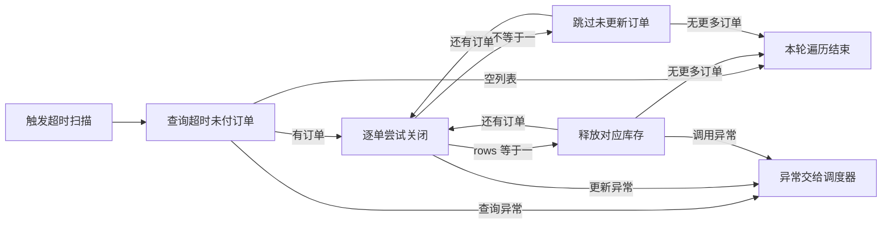

# 超时关单
状态：梳理中
限制：有

## 职责与边界

定时方法查询超过 30 分钟的 UNPAID 订单，遍历并以旧状态条件更新为 CLOSED，仅 update 返回 1 时调用库存释放。当前方法没有 @Transactional 或局部 catch；调度是否启用、实际时区和全局拦截行为未提供。

## 执行图

## 逐节点短注

| 节点 ID | 原标签 | 简短说明 | 去向 |
| --- | --- | --- | --- |
| A | 触发超时扫描 | cron 声明每五分钟触发 | 无 |
| B | 查询超时未付订单 | 早于本机当前时间减三十分钟 | 无 |
| C | 逐单尝试关闭 | 更新条件含 id 与 UNPAID | 无 |
| D | 释放对应库存 | 仅更新一行时传 skuId 与 qty | 无 |
| E | 跳过未更新订单 | 非一行时不调用库存释放 | 无 |
| F | 本轮遍历结束 | 无更多订单则方法结束 | 无 |
| X | 异常交给调度器 | 方法无 catch 或局部重试 | 无 |

## 必要规则与源码依据

事实：OrderTimeoutJob.java:6-8 声明 cron="0 */5 * * * *"，查询参数为 LocalDateTime.now().minusMinutes(30)。OrderMapper.xml:6-8 条件是 status = UNPAID 且 create_time < before，不含等于。cron 的五分钟含义是基于通常的六字段解释；未提供真实调度启用和时区配置，不声称已经定时运行。

事实：OrderTimeoutJob.java:9-13 遍历结果，updateStatus(id,UNPAID,CLOSED)，rows == 1 才 release(skuId,qty)。OrderMapper.xml:9-11 的 UPDATE 同时匹配 id 与旧状态，SQL 有条件写入；不能仅凭 SQL 断言完整并发和事务语义。

事实：StockClient.java:6-7 定义 stock-service 的 POST /stock/release，返回 void。调用返回不等于业务释放成功的已证结果。源码顺序是先更新状态，再调用释放，当前 job 无 catch；任一调用抛异常会使当前方法退出，后续订单不会由本次调用继续处理。框架如何捕获、以后是否重跑未知。

待核实：数据库提交时机、释放失败后的补偿、外部幂等与调度实际生效，见未决和 COVERAGE 范围限制。

## 下钻、引用与外部去向

本流程由调度触发；[创建订单](10-创建订单.md) 写入 orders、UNPAID 与 create_time=NOW()，本流程按 UNPAID 与 create_time<now-30分钟读取，形成有条件的持久化状态交接。只有写入可见、状态仍匹配且达到时间条件时该记录才可能进入本流程，不是同步调用。库存 release 与创建流程 deduct 只共享客户端名称，输入和外部行为不同，当前不抽公共模块。

## 候选记录

扫描范围：OrderTimeoutJob.closeTimeoutOrders、OrderMapper.selectUnpaidBefore/updateStatus、StockClient.release 全部提供内容
扫描方法：逐行读取；rg -n "Scheduled|selectUnpaidBefore|updateStatus|release|rows|minusMinutes" src/tests/fixtures/source
检查对象数：6
未检查区域：无

| 来源位置 | 候选 | 类别 | 数量 | 处置 | 证据或去向 |
| --- | --- | --- | --- | --- | --- |
| OrderTimeoutJob.java:6-8 | 调度及超时筛选 | MQ异步后台 | 1 | 本文已解释 | [触发与条件](#必要规则与源码依据) |
| OrderTimeoutJob.java:9 | 遍历每条订单 | 其他 | 1 | 本文已解释 | [逐单处理](#C) |
| OrderTimeoutJob.java:10; OrderMapper.xml:9-11 | 按旧状态条件关单 | 写库缓存状态 | 1 | 本文已解释 | [条件写库](#必要规则与源码依据) |
| OrderTimeoutJob.java:11 | 仅更新一行才释放 | 权限判断算法 | 1 | 本文已解释 | [分支](#D) |
| OrderTimeoutJob.java:10-12; StockClient.java:6-7 | 关单后释放库存 | 外部调用副作用 | 1 | 待核实 | [库存一致性限制](#未决) |
| OrderTimeoutJob.java:7-15 | 异常结束本轮执行 | 异常重试补偿 | 1 | 本文已解释 | [异常出口](#X) |

## 未决

| 来源 | 类型 | 问题 | 下一步 | 已尝试方法 | 缺失依据 | 影响 | 重试条件 |
| --- | --- | --- | --- | --- | --- | --- | --- |
| OrderTimeoutJob.java:10-12; StockClient.java:6-7 / 关单后释放库存 | 限制 | 状态更新在释放调用之前；释放失败、重复调用和跨实例并发下的一致性契约缺失。 | 取得事务/mapper 运行配置与库存 release 契约，核实 update 返回值、提交时机、幂等、重试或补偿。 | 阅读 job、SQL、Feign 接口；全范围搜索 release、Transactional、try、catch | 事务与数据库运行配置、release 错误及幂等契约 | 不能证明 CLOSED 与已释放总是一致；释放异常时剩余订单处理会退出当前方法，但调度容器后续处理未知 | 补充运行配置与库存契约 |

## 限制说明

见[未决](#未决)中的限制记录；不新增一份任务。

## 核验与下一步

已核实严格早于阈值、条件更新、rows 分支及异常打断遍历；下一步核实库存释放契约和远端质疑。 全部提供文件已逐行本地阅读，尚未经过远端质疑，不切换完成状态。未执行项目运行测试：样例缺少构建文件与依赖实现。Mermaid 节点、分支和边已人工核对；未发现 mmdc，未执行完整 Mermaid 自动语法验证。机械检查结果见[检查记录](../CHECKS.md)。
