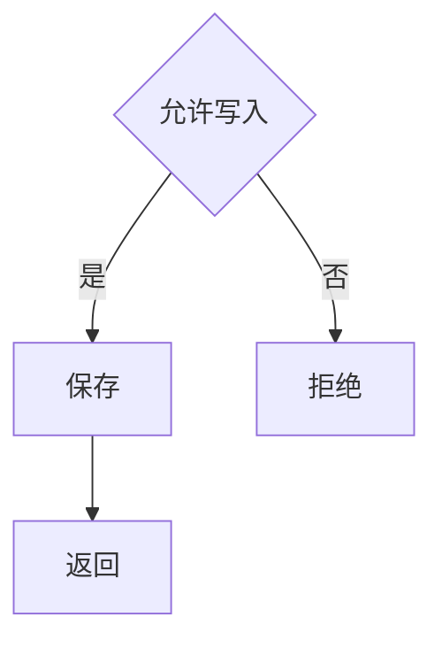

# 保存
状态：梳理中
限制：无

## 职责与边界

allowed为真时向store追加value并返回；为假时抛PermissionError，store不变。

## 执行图

## 逐节点短注

| 节点 ID | 原标签 | 简短说明 | 去向 |
| --- | --- | --- | --- |
| Q | 允许写入 | 以allowed布尔值决定 | 无 |
| D | 拒绝 | 抛PermissionError且不写入 | 无 |
| A | 保存 | 写入记录后返回结果 | 无 |
| B | 返回 | 返回保存结果 | 无 |

## 必要规则与源码依据

fixture.py:save 在第2-3行检查allowed，为假抛PermissionError；通过后第4行store.append(value)，第5行返回value。本轮无外部运行配置。

## 下钻、引用与外部去向

沿图中引用继续阅读。

## 候选记录

扫描范围：合成夹具完整执行体
扫描方法：逐行读 fixture.py 的 save 和返回
检查对象数：3
未检查区域：无

| 来源位置 | 候选 | 类别 | 数量 | 处置 | 证据或去向 |
| --- | --- | --- | --- | --- | --- |
| fixture.py:2 | 许可条件 | 权限判断算法 | 1 | 本文已解释 | [规则](#规则) |
| fixture.py:3 | 拒绝出口 | 异常重试补偿 | 1 | 本文已解释 | [规则](#规则) |
| fixture.py:save | 保存记录 | 写库缓存状态 | 1 | 本文已解释 | [规则](#规则) |

## 闸门记录

| 检查项 | 检查范围 | 对象数 | 问题数 | 其中阻塞本层 | 说明 |
| --- | --- | --- | --- | --- | --- |
| 入口 → 结果 | 合成夹具全范围 | 1 | 0 | 0 | 已检查此结构断言 |
| 源码 → 流程 | 合成夹具全范围 | 1 | 0 | 0 | 已检查此结构断言 |
| 封装 → 隐藏环节 | 合成夹具全范围 | 1 | 0 | 0 | 已检查此结构断言 |
| 未决 → 处置 | 合成夹具全范围 | 1 | 0 | 0 | 已检查此结构断言 |

## 未决

| 来源 | 类型 | 问题 | 下一步 | 已尝试方法 | 缺失依据 | 影响 | 重试条件 |
| --- | --- | --- | --- | --- | --- | --- | --- |

## 限制说明

无

## 核验与下一步

模拟远端质疑与完整文件已收到；source/fixture.py:1-5和许可/拒绝分支实测见外部验收证据。候选条件、写入、拒绝已逐项核实；叶子无未落实的重要阶段。完整Mermaid渲染未验证，节点和边已人工比对。

## 验收记录

拟完成类型：未取得
读者内容指纹：未验证
核验基准：未取得
用户验收问题：未取得
用户验收回答：未取得
